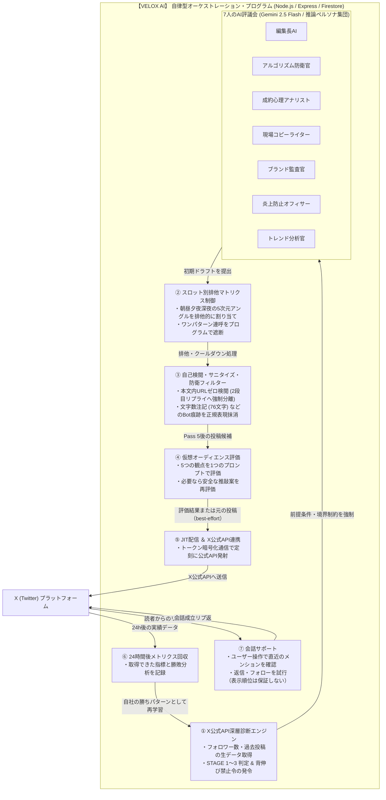
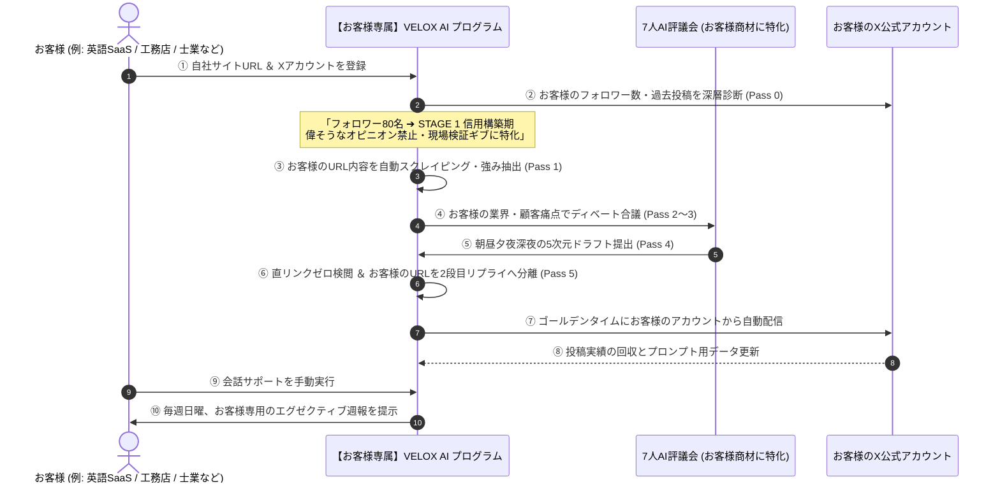

# ⚡ VELOX AI 4.0 統合アーキテクチャ・自律進化仕様書
> **文書ステータス**: 公式生きた仕様書 (Living Architecture & Evolution Spec)  
> **バージョン**: `v4.3.5` (投稿エラー案内と投稿言語表示の改善)  
> **最終更新日時**: 2026-11-16  
> **対象リポジトリ**: `x-nurture-factory` (VeloxPost Cloud 4.0)  
> **運用方針**: 本文書は機能改良・アルゴリズム進化のたびに最新の設計と挙動を書き直し、常に最新のシステム実態と一致させる。

---

## 投稿の安全性（本番反映状況に注意）

- 2026-11-15：先行反映では `x-shop`、`x-reply-engine`、`x-batch-engine` を再読み込みしましたが、`x-admin-ui` は未再読み込みでした。実際のX認証・投稿は未検証です。
- 2026-11-15 22:32 UTC：今回の変更を反映するため `x-admin-ui` と `x-shop` のみPM2再起動し、両プロセスがonlineであることを確認しました。`/dashboard` は認証画面への転送後HTTP 200、未認証の週報APIはHTTP 401でした。`x-shop` の既存予約ワーカーは再開しており、期限到来ジョブの送信・予約補充が行われる可能性があります。他プロセスは再起動していません。認証済み画面、実X投稿、Firestore上の結果データは検証していません。
- Xログインと連携で新たに要求するOAuth権限を `tweet.read`、`tweet.write`、`users.read`、`offline.access` の4つに絞り、本番の認証リダイレクトで確認しました。既存の認可や、既に開いている認証画面は自動的に変更されません。X側の認証画面と実際の認証完了は未検証です。
- ダッシュボードのバナー、週報の概要、AI処理モーダルと診断結果の共有欄を明るい配色に揃えました。X連携の説明とA/B実験の画面表示も日英に対応しています。投稿本文・AI生成内容やX側の画面は表示言語によって自動翻訳されません。
- 直前生成の予約枠では、本文が未確定であることを表示し、保存済みデータと未保存の参考サンプルは区別した折りたたみ欄に表示します。サンプルは実際の投稿内容ではありません。枠のラベルには固定時刻を付けず、実際の予約日時とタイムゾーンを表示します。予約・投稿の動作は変更していません。

- 公式APIの予約投稿は、連携Xアカウントごとの明示的同意が必要です。既存ユーザーも同意するまで待機し、管理画面から同意・撤回できます。撤回は一時停止も行い、保留予約は削除しません。自動補充は未同意・停止中のユーザーを除外し、自動送信前にも同意と停止を再確認します。ユーザーが個別に実行する「今すぐ投稿」はこの同意・停止判定の対象外です。最終確認後に停止した場合、すでに送信中の投稿やスレッドは止められない可能性があります。他の投稿経路は未対応です。
- 管理画面でXを連携するとき、利用規約・プライバシーポリシーへの同意を必須とし、自動投稿への同意は別の任意チェック欄にします。認証したXアカウントのIDに同意を記録し、既存の一時停止は解除しません。チェックを外して連携しても既存の同意は撤回されず、撤回は自動投稿欄から行います。APIキー直接設定も同じチェック欄を使用します。この画面と `x-shop` の変更は反映済みですが、実際のX認証は未検証です。
- 所有者の依頼により、確認できた @VeloxSystemsHQ と @VeloxSystemsV4 の連携先には自動投稿への同意を本番DBに記録済みです。停止設定は変更していません。
- JITは宣伝先とユーザー指示に一致する保存済み戦略を参照します。本人の有効な24〜36時間実績を優先し、フォロワー数が公式取得済みで連携アカウントと一致する場合は、本人より1人以上多く `max(本人+20, 本人×3)` 以下の外部アカウントの投稿構造も補助的に参照します。フォロワー数は診断時点の値であり、成長過程は判明しません。取得失敗時は警告を記録して参考情報なしで続行する場合があります。
- 信用構築中または段階未確認のアカウントでは宣伝枠を作らず、旧JIT宣伝枠も情報提供として生成します。URLらしい文字列を含む自動投稿や、宣伝指定の既存非JIT投稿は停止します。検出は完全ではなく、意味による宣伝判定も保証できません。明示的な手動投稿は対象外です。段階確認済みの他アカウントでは、通常計画のBusiness深夜・Pro夜とStarter朝の隔日、手動予約のBusiness/Pro夜・Starter朝の隔日を宣伝枠とします。宣伝枠では本文と返信にPRを付け、返信に最初のURLを付けます。途中失敗時は自動再送しません。
- 信用構築の目標はフォロワー100人または1投稿の公開後24時間ビュー1,000回です。公式データで100人未満、または初期ステージと診断された連携アカウントを信用構築として記録し、自動移行しません。Xアカウントの一致や実測フォロワーを確認できなければ段階未確認として扱います。現状は段階変更の画面がなく、24〜36時間に採取する既存スナップショットは厳密な24時間達成を証明できません。取得情報が古い場合もあります。
- Xの事前承認が未取得のため、公式自律エンゲージメントのAI返信・自動フォローは全段階で停止し、画面にも自動返信の停止を表示します。X側の返信受信設定は変更しません。候補の収集・承認画面と承認後の返信上限100件／日・フォロー上限10件／日の仕組みは未実装です。自己スレッドを含むほかの投稿・返信経路は未検証です。[X開発者ガイド](https://docs.x.com/developer-guidelines)の承認・同意・一括フォロー等の条件を確認してください。
- 公式投稿後の自動応援案件の新規登録と、育成・返信エンジンによるブラウザー自動応援・返信を停止する変更を加えました。育成、初期設定、ライブテスト、旧SaaSエンジン等の確認済みブラウザー操作も対象です。既存データは削除しません。公式APIの収集タイマーは残しますが、非公式のアクセス経路はまだ他にもあり、全経路を停止したとは保証できません。`x-admin-ui` は未再読み込みです。
- 旧管理画面の非公式検査を伴う交換・販売・在庫診断・凍結診断と、定期在庫検査を停止します。検査できないことを不良と誤判定してアカウント状態を更新しません。初期設定と育成の旧ワーカーの起動も停止します。
- Xの開発者契約にはXデータを基盤モデルの学習・ファインチューニングに使うことへの制限があります。投稿例や集計をGeminiへの指示に利用する現在の方式が許可されるか、利用条件・第三者へのデータ提供も含めXに確認が必要です。プロンプトへの参照とモデルの学習を同一視せず、承認済みとは扱いません。
- 画面から現在の宣伝先のASP日別クリック・成約数を手入力できます。未取得値は空欄のまま保存できますが、両方空欄では保存できません。ユーザーとURLごとに分け、日付読み込み後にURLが変われば保存を拒否します。JITは最新7記録を参考にしますが、他媒体を含む日別集計であり、個別のX投稿へ成果を帰属しません。
- 投稿直前の生成には保存済み計画と新しい実績を照らし次の切り口を検討する指示を追加しました。これはモデルへの指示であり改善を保証しません。保存済み戦略レポート自体を実績に応じて自動更新する仕組みや、成約の自動計測は未実装です。宣伝表記やリンクの使用について、各国の規制とASPの個別規約を確認する必要があります。
- JIT生成は宣伝先ページの抜粋とユーザー指示をGeminiへ渡します。取得不能・内容が空、生成中の宣伝先・指示変更時は送信を停止します。複数URLの取得は一部成功でも成功扱いです。ページ・URL・指示を外部モデルへ送るため機密情報を含めないでください。
- JITは業種・言語・構造別のコーパス集計最大32グループと、当該ユーザーの最大100件の候補から有効な24〜36時間凍結スナップショットの高低両側を最大5件参照します。低反応の記録も集計対象です。旧コーパスの欠損と区別できないゼロは除外し、新規X API収集には収集経路と指標の有無を記録します。数値の投稿ID以外のシード等はJIT集計から除外しますが、数値IDも実在や正確性の証明にはなりません。元投稿文や他ユーザーの個別実績は渡しません。
- JITはページ内容から業種と読者を推定し、他業種・他言語からも構造を応用するようGeminiへ指示します。これは分類精度や成果を保証しません。コーパスの旧記録は出所・実測性が未検証で、反応と因果関係を混同しません。
- 約100アカウントすべてが収集しているとは確認できていません。4時間ごとの既存バッチは2ユーザーの認証情報を使った検索が中心です。実環境の稼働・本番データは未確認です。顧客間の個別履歴をJITに共有する処理は今回追加しておらず、共有には同意・匿名化・アクセス制御等の設計が必要です。
- 宣伝先の一部の一時的な取得エラーとGeminiの認識できる一時障害はそれぞれ最大3回試行します。Geminiは1回30秒、429は認識可能な30秒以内の待機指定がある場合のみ再試行します。費用が増える可能性があり、上限後はジョブを失敗として記録し、後から自動再試行しません。X送信の自動再試行は追加していません。
- **公開運用前に要対応**: 既存のURL取得は内部ネットワークやリダイレクト先の制限、応答サイズの上限がなく、外部ページの命令混入も完全には防げません。メール等の能動的な障害通知、長時間障害後の自動復旧は未実装です。今回のコード変更は実Gemini・実X APIで未検証で、反映後の実投稿は確認していません。
- 画面の投稿言語選択は認証済みユーザーの設定に保存し、予約を削除・再作成しません。英語設定で英語本文がない自動投稿、または送信本文にかな・漢字等を含む自動投稿は停止します。待機一覧にも警告します。明示的な手動指定には言語検査を適用しません。
- 英語かどうかの完全な判定ではなく、日本語の引用や固有名詞なども停止する場合があります。送信直前に設定変更を再確認しますが、その後に変更されると処理中の投稿は旧設定で送られ得ます。他の返信・投稿経路は未検証です。実アカウントの今回の原因は未特定で、本番反映や実投稿は行っていません。
- JIT生成のAI設定不足・生成エラー・不正な本文は投稿を停止します。市場分析・アカウント戦略・合議計画の生成失敗は定型の代替結果を返さず停止します。合議計画はプランごとの件数・時間帯・連番と必須項目を検証します。他の生成指示に含まれる未確認の主張や、AI出力の事実性は未解決です。
- キャンペーン起動時にユーザー設定を読み取れない場合や保存済みタイムゾーンが無効な場合は、診断・生成前に停止します。既に作成済みのJIT予約は自動的に停止しません。
- プレビューと予約の再検討はアカウント診断を取得せずに実行します。再検討は最大20件の待機予約が対象で、対象URLの欠損・不一致・取得失敗時は停止します。処理中に対象予約またはユーザー情報が変更された場合、更新を一括中止してHTTP 409を返します。JIT予約の本文は投稿直前に別途生成されます。
- 新規ユーザーには架空の成功・失敗実績を与えず、既知の旧固定例は読み取り時のみ除外します。保存済みデータは変更せず、他の架空例や実績の正確性は未検証です。
- 合議投稿の初期生成に失敗した場合、または計画・日本語・英語の本文が不足・不正な場合は、定型投稿で代替せずエラーにします。戦略生成の失敗は画面に表示しますが、先に作成されたJIT予約は停止せず投稿される可能性があります。AIによる内容の正確性は保証されません。
- 新規予約計画、手動JIT予約、合議予約はUUIDを含むIDを使い、対象文書の作成時は既存文書を上書きしません。既存のIDは変更しません。
- 新しく取得する実績値は非負の安全な整数を有効とし、不正な値は欠損として扱います。保存済み比較値のインプレッションまたはブックマークが不正な場合は学習対象に含めません。
- 24〜36時間のスナップショットとA/B分析の24〜25時間枠は、経過時間を丸めずに判定します。A/B分析でも不正な比較値を除外します。過去に凍結済みのスナップショットは変更していません。
- 実績同期は各ユーザーの処理時刻で回収要否を判定し、判定エラーを記録して他のユーザーを続行します。巡回は逐次処理で、中断時に途中から再開する仕組みはありません。
- 1,000顧客の同時運用は未検証です。自動補充は1回最大250ユーザーを巡回します。投稿ワーカーの予約取得・処理数の制限や、履歴の全件読み取りが残っています。
- 自動補充はユーザーの更新時刻を条件に予約を作成し、競合した変更があれば失敗します。一時停止は解除せず、補充日時は基準日時より後に設定します。別の予約作成経路との競合は未解決です。
- 手動JIT予約もユーザーの更新時刻を条件に作成します。競合時はHTTP 409を返し、画面で日英の確認案内を表示します。他の予約作成経路は未対応です。
- 手動JIT予約の時刻はユーザー設定のタイムゾーンで計算します。既存予約の日時は変更しません。
- 合議予約はセッション所有者のみが作成でき、ジョブと承認状態を一括保存します。競合や承認済みセッションの再送はHTTP 409を返します。予約削除後も同じセッションは再利用できません。
- 投稿ワーカーは待機中の予約を文書ID順に最大100件ずつ巡回し、1分ごとの1回につき期限到来済みの最大3件を実行します。各予約を確認する時点で期限を判定し、取得時に最新の予約日時を再確認します。カーソルはプロセス内で保持し、再起動時は先頭から巡回します。
- インメモリDBとX APIモックで1,000顧客が同時に1件ずつ投稿する場合、1ワーカーで334巡回を要しました。最初の巡回から最後まで少なくとも5時間33分となり、実環境ではさらに遅れる可能性があります。実際の負荷試験ではなく、処理能力の改善も未実施です。
- 自動投稿と手動即時投稿は、待機中ジョブのみをトランザクションで処理中に変更してから実行します。処理中・失敗・投稿済みの即時再投稿は拒否します。
- 処理中の予約は削除できません。30分経過による自動再投稿は行わず、X上の状況確認を案内します。失敗時も一部が投稿済みの可能性があるため、再作成前にXで確認してください。
- 処理中・失敗のジョブには、保存済み本文と記録された数字の投稿IDへのXリンクを確認用に表示します。保存本文は投稿完了を証明しません。
- 単発投稿のX API成功後に結果保存が失敗し、成功応答の印とIDを保存できた新規ジョブは、所有者が連携Xアカウントの直近100件と照合して履歴を復旧できます。一致しない場合やジョブ・ユーザーの変更時は復旧せず、再投稿もしません。復旧者・XユーザーID・復旧時刻を記録します。照合ではトークンを更新せず、応援キャンペーンの再登録も行いません。期限切れの場合は失敗し、API利用料金も発生し得ます。実クライアントはHTTPモックで検証済みですが、実X APIへの接続と認証は未検証です。
- JIT本文が空の場合や保存に失敗した場合は投稿しません。スレッド途中の失敗では、応答で確認できた投稿IDを記録します。
- X APIが投稿成功を返した後に結果の保存が失敗した場合、可能なら投稿IDとURLを失敗記録に残し、X上の確認を案内します。失敗記録の保存も失敗する場合はサーバーログに記録します。
- 予約入れ替え時は、取得後に変更された既存予約を削除せず、バッチを失敗させます。
- Xへの送信結果が不明な場合や、投稿後のDB保存が失敗した場合の完全な照合・復旧は未実装です。二重投稿の完全防止は保証できません。

---

## 1. VELOX AIの根本定義と位置づけ

### 💡 「LLMは単なる文章生成機に過ぎない」
世間に溢れる「ChatGPTラッパー」や「AI自動投稿ツール」は、プロンプトをそのままLLMに投げるだけの薄い仕組みであり、金太郎飴、インフルエンサー風の背伸び、本文直リンクによるアルゴリズム強制減衰によって自滅します。

**VELOX AIの実体は、単一のLLMではなく、サーバー上で稼働する「自律型オーケストレーション・オペレーティングシステム（Cognitive OS）」プログラムです。**
X公式APIからアカウントの生データを取得し、ステージを判定し、LLMを厳しいルールと制約で縛り、生成されたテキストを検閲・自己修復し、投稿後の結果から自己進化する**前後のプログラム基盤すべて**を「VELOX AI」と定義します。

---

## 2. 「プログラムとしてのVELOX AI」と「7人のAI評議会」の役割分担

### 比較表：誰が何をしているのか？

| 比較項目 | 7人のAI評議会 | プログラムとしての VELOX AI |
| :--- | :--- | :--- |
| **実体** | LLM（Gemini）内部で動作する**推論・議論ペルソナ** | サーバー上で24時間稼働する**制御プログラム（TypeScript/Node.js）** |
| **役割** | アイデア出し、反論ディベート、文章ドラフト執筆 | **X APIデータ収集、ルール強制、検閲、配信、自己進化学習、リプ返ブースト** |
| **弱点** | 放っておくと背伸びし、ワンパターンになり、URLを直貼りする | 自らゼロから文章を書く詩的センスはない |
| **主従関係** | **VELOX AIの掌の上で議論させられている存在** | **7人を手綱で操り、失敗させない「最高執行司令塔」** |

---

## 3. 自社アカウント運用時 vs お客様アカウント運用時の挙動マトリクス

VELOX AIは完全マルチテナント設計（Firestore `saas_users/{userId}` で暗号化・完全分離）となっており、**自社アカウント運用時とお客アカウント運用時で、以下のように自律的に挙動を切り替えます。**

---

## 4. 最先端テクノロジーの統合アーキテクチャ (v4.3.2)

### ① 会話サポート
* **VELOX AIの挙動**:
  * `POST /api/autopilot/boost-conversations` はユーザー操作で実行されます。
  * 実行時に直近最大10件のメンションを確認し、未処理分への返信・フォローを試みます。
  * XのAPI制限、アカウント状態、推薦システムの判断に依存します。返信やフォロー、表示順位の上昇は保証されません。

### ② 【MAP-Elites 品質多様性格子】記録と探索
* **目的**: 投稿の切り口・形式・対象読者の組み合わせを分け、投稿生成時にアーカイブ例や反省メモを参照します。
* **VELOX AIの挙動**:
  * 行動アングル（5種）× 構造フォーマット（3種）× 対象読者（2種）のセルを定義しています。
  * 生成時に1つのセルをサンプルし、実績を持つ投稿ジョブにセルIDを保存します。
  * 実績回収時は、保存されたセルIDがある投稿のみを対象に、取得できた表示回数・いいね・ブックマーク・引用等からスコアを算出し、セルの最高記録を更新します。プロフィールクリックは測定していません。
  * 固定の架空実績は使いません。アーカイブが空なら未検証の探索候補を返し、数値や体験を創作しないよう指示します。データがあれば20%の探索を行いますが、生成品質や成果の向上を保証するものではありません。保存済みアーカイブの由来は検証していません。

### ③ 【オンラインDPO（Direct Preference Optimization）】動的対比学習
* **実装上の位置づけ**: モデルの追加学習（DPO最適化）は行わず、生成時に参照する対比例を保存・注入します。
* **VELOX AIの挙動**:
  * 投稿実績から勝者・敗者のペアを作成し、次回の投稿生成プロンプトに対比例として注入します。
  * 比較対象や順位付けは取得可能なメトリクスに基づきます。ペアの蓄積のみでモデル自体が学習・改善するわけではありません。

### ④ スコアに基づく反省メモ
* スコアと因果関係が未検証である旨を記録し、セルの記録更新時にアーカイブします。旧反省文は生成時にそのまま使用せず、保存済みデータも削除しません。
* 7名AIの批評を自動要約したものではなく、同じ失敗を防ぐ保証もありません。対比例や知識同期には未検証の因果説明が残っています。

### ⑤ 【仮想オーディエンス評価器】5観点による事前評価 (`src/audience_simulation_engine.js`)
* **実装内容**: 投稿生成フロー（Pass 6）とプレビュー生成に組み込み、5つのペルソナ観点を1つのGeminiプロンプトで評価します。独立した5モデルやモンテカルロ試行ではありません。
* **VELOX AIの挙動**:
  * 投稿ドラフトに対して各ペルソナの0〜100点評価を受け取り、設定済みの重みで総合点を再計算します。80点基準の評価フラグと改善アドバイスも返します。スコアは実際の反応を予測・保証するものではありません。
  * 80点未満で推敲文が提示された場合、安全化した文面を再採点し、スコアが上がった場合のみ差し替えます。
  * APIキー未設定時やAPIエラー時は静的ヒューリスティック評価へフォールバックし、`evaluationMethod` で方式を区別します。推敲案がない場合は書き換えません。
  * 評価はbest-effortで、評価に失敗しても元の投稿候補を維持します。80点未満を投稿前にブロックするゲートではなく、85点以上のみを配信する仕様でもありません。
  * `launchAutopilotCampaign` は評価メタデータをジョブに保存します。`generateInstantPreviewPosts` はレスポンスに含めますが、永続保存はしません。
  * 文ごとの感情トーンは既存LLM呼び出しで概算し、DTW参照曲線との距離を `linguisticAnalysis.sentimentArc` に記録します。未校正の参考情報であり、総合点・推敲・投稿可否には影響しません。文数不一致やフォールバック時は未測定です。

### ⑥ 【自己進化メタプロンプト最適化】OPRO着想のプロンプト自己更新 (`src/meta_prompt_optimizer.js`)
* **実装内容**: 過去の投稿実績を上位・下位にクラスタリング（複合スコア）し、成功・失敗の構文傾向を抽出。執筆プロンプト指示書（Directives）の追加・改善案を生成。
* **VELOX AIの挙動**:
  * 必須ルールはベースラインの不変指示書から復元し、更新案が同じID・本文・不変属性を保つことを検証します。
  * 実績データ不足時やAPIエラー時は既存の指示書をそのまま維持（best-effort）。
  * 投稿実績が6件以上ある場合に、ユーザー自身の投稿実績を分析し、更新案を `saas_users/{userId}` へ保存します。変更理由は最大20件の `promptDirectivesChangeLog` に記録します。
  * キャンペーン生成では保存済み指示を読み込み、必須不変ルールを復元した上で補助指示としてPass 4のプロンプトへ適用します。ユーザー指示や明示的制約と矛盾する補助指示は無視するよう指定しています。

### ⑦ 【エピソード記憶ストア】構文パターンの蓄積と検索 (`src/episodic_memory_store.js`)
* **実装内容**: 投稿実績からWINNER/FAILURE/NEUTRALの構造化エピソードを作成し、渡された配列から検索・整形するユーティリティです。
* **VELOX AIの挙動**:
  * ターゲットアングルの一致度、キーワードの重複度、品質スコアに基づいて関連エピソードをランキング検索。
  * 検索された成功例・失敗例を、生成プロンプト（Few-Shot）へ埋め込めるMarkdownフォーマットへ自動整形。
  * 実績同期で既存の投稿ジョブと照合でき、インプレッションがある投稿だけを `saas_users/{userId}/episodic_memories/tweet_{tweetId}` に保存します。投稿本文は引用データとして扱い、文中の指示を実行しない旨をプロンプトに含めます。
  * キャンペーン生成時に同一ユーザーの直近最大100件を読み込み、各投稿計画に関連する成功例・失敗例を最大1件ずつPass 4へ注入します。保持データの自動削除・期限切れ処理はありません。

---

## 5. 改良・進化履歴 (Version & Evolution Log)

### [v4.3.5] - 2026-11-16 (CURRENT)
* **即時投稿エラーの案内**: 投稿前履歴の取得でFirestore複合インデックス不足が起きた場合、内部ログに詳細を残し、画面には「今回はXに送信していない」と分かる案内を返します。ジョブは保留状態を維持し、再試行は5分間隔に制限します。
* **投稿言語の明示**: 予約カードに実際に選択される投稿言語を表示します。JIT枠では保存済み下書きは使われず、参考サンプルも投稿されないことを区別し、「今すぐ投稿」は実公開であることと、動的枠ではその場で本文を生成することを確認画面に明記しました。
* **JIT言語記録**: 新しく作るJIT予約枠にも投稿言語を保存し、既存どおりアカウントの現在の投稿言語設定を優先して配信言語を決定します。
* **検証**: 関連テストは35件成功、1件スキップ、失敗0件。スキップはFirestore Emulatorが未起動のためです。Node.jsテストランナーの一時的なシリアライズエラーが発生したテストも直接実行では18件成功しました。変更したサーバーJavaScriptとダッシュボード内スクリプトの構文も確認しました。実X投稿は行っていません。
* **反映状況**: 許可を得て `x-shop` を再起動し、プロセスonlineとローカル・公開 `/dashboard` の未認証HTTP 302を確認しました。14日トライアルと画面・エラー案内の変更は稼働中です。ユーザー確認によりFirestoreは移行されておらず、旧プロジェクトを継続利用しています。アプリ設定上のプロジェクトID `tidal-airway-401213` へのインデックスデプロイは、Firebase CLI利用者・アプリサービスアカウント双方で403となり、インデックス変更は行われていません。必要な権限を持つFirebaseプロジェクト管理者による反映が必要です。インデックスが有効になるまでは投稿前の安全確認が失敗する可能性があります。

### [v4.3.4] - 2026-11-15
* **14日間無料トライアル**: 新規Stripe Checkoutセッションの `trial_period_days` を14日に変更しました。既存のStripeサブスクリプションは変更しません。
* **販売表示の整合**: 日英ランディングページ、管理画面、特定商取引法に基づく表記、購入案内を14日間の条件に統一しました。無料期間終了後の月額自動更新と解約期限を購入前に表示します。
* **機能説明の見直し**: AI投稿案の作成・レビュー、予約配信、アカウント管理、取得可能な実績確認を中心に説明し、成果保証や自動エンゲージメントの販売訴求を削除しました。プラン差は投稿上限・運用レーン・接続枠として明示し、AI投稿支援は全プラン共通としています。
* **検証**: `node --test --test-concurrency=1` は240件成功、3件スキップ、失敗0件。変更したJavaScriptとLP内スクリプトの構文、LP翻訳キー212件を確認しました。並列実行ではNode.jsテストランナーのデータ復元エラーが1件発生しましたが、該当テスト単独と直列の全テストは成功しました。
* **反映状況**: コード・表示変更のみ。本番環境へのデプロイと `x-shop` 再起動は未実施です。

### [v4.3.3] - 2026-11-15
* **重複投稿の抑止 (`src/post_content_guard.js`, `src/hybrid_saas_routes.js`)**: Unicode幅、空白、不可視文字を正規化した本文の完全一致を送信直前に検査し、同一アカウントの投稿をFirestoreリースで直列化します。投稿済み・処理中・送信結果が確定していない失敗ジョブと、スレッド内の各本文も照合します。意味的な類似判定や自動書き換えは行いません。
* **X送信の再試行・不明結果の扱い (`src/official_api_client.js`)**: HTTP 403時の同一POST再送を廃止し、401のみOAuth更新後に一度再試行します。投稿要求は20秒でタイムアウトし、送信の結果が不明なエラーは自動再送せず記録します。
* **JITタイムアウト識別 (`src/ai_deliberation_council.js`)**: 最終タイムアウトを `jit_generation_timeout` として保持します。既存の1回30秒・最大3回の設定は変更していません。
* **検証・反映状況**: 重複防止・投稿API・JIT関連の対象テスト26件、および全体テスト240件が成功（3件スキップ、失敗0件）。Firestore Emulator結合テストは実行環境にEmulatorがなく未検証です。許可を得て `x-shop` のみPM2再起動し、online状態と `/dashboard` のHTTP 302（ログイン画面へ転送）を確認しました。既存の予約ワーカーは再開しており、期限到来ジョブが実行される可能性があります。実X投稿・認証済み画面・本番データは未検証です。

### [v4.3.1] - 2026-11-15
* **投稿前のコンプライアンス確認 (`src/post_policy_guard.js`)**: 宣伝表示漏れ、応募条件付きエンゲージメント誘導、根拠確認が必要な数値・成果主張の候補を自動投稿直前に検出し、該当ジョブのX送信を停止して人手確認に回します。文字列検査のため見落とし・誤検知があり、法令適合やX規約遵守を認証するものではありません。
* **実測レポート**: アカウント診断・週報は取得上限300件内の凍結済み24時間メトリクスを集計し、データがない場合は未測定と表示します。週報の切り口比較は記述的な指標比較に限り、因果効果や将来成果を推定しません。架空スコアや固定サンプル結果を除去しました。
* **日本語・英語表示**: 週報の見出し・集計結果・未測定表示・次週の確認項目を管理画面の選択言語に合わせます。動的リストはテキストノードで描画します。
* **分析機能の範囲**: `src/linguistic_analyzer.js` の日本語文字数・英語単語数は概算情報です。感情推定やDTW参照曲線を使った投稿の自動合否判定はこの時点では本番フローに接続していません。
* **反映・確認**: `x-admin-ui` と `x-shop` をPM2再起動し、online状態とHTTP応答を確認しました。`npm test`: 235 passed、3 skipped、0 failed。認証済みX投稿、実X API、実Firestoreデータは未検証です。`x-shop` 再起動後は既存予約ワーカーが再開します。

### [v4.3.2] - 2026-11-15
* **文ごとの感情トーン参考分析**: 既存の仮想オーディエンス評価LLM呼び出しに文相当セグメントごとの -1〜1 の概算値を追加し、検証後にDTW参照曲線との距離を `audienceSimulation.linguisticAnalysis.sentimentArc` へ付与します。追加のAPI呼び出しはありません。
* **Geminiモデル互換性**: 旧モデルIDがAPIから404を返していたため、仮想オーディエンス評価器を `gemini-3.8-flash` に合わせました。
* **安全な扱い**: 推定値・参照曲線はいずれも未校正・未検証です。総合点、推敲採否、投稿可否、配信順位に影響させず、フォールバック時・値不正時は未測定とします。文長統計は引き続き概算で、読解力スコアではありません。
* **検証・本番反映**: 関連テスト13件成功、全体テスト237件成功・3件スキップ・失敗0件。`x-shop` を再起動し、online状態とHTTP 200を確認しました。架空の短文を使ったGemini 3.8 Flashの実API評価で2文分の推定値とDTW参考距離を確認し、テスト投稿は送っていません。実アカウントの投稿結果や成長効果は未検証です。`x-shop` の既存ワーカーは再開しています。

### [v4.3.0] - 2026-11-15
* **実績計測の厳密化・欠損除外・24hウィンドウ固定化 (`src/metrics_harvest_engine.js`)**:
  * `createdAt` / `created_at` のプロパティ名不整合を解消し、API応答の投稿日時から正確に経過時間（`postAgeHours`）を計算。
  * `normalizeTweetMetrics`: ブックマークやインプレッションの欠損（`null`/`undefined`）をゼロに暗黙変換せず、欠損（`isMissing: true`）として厳格分離。
  * `resolve24hMetricsSnapshot`: 24〜36時間の観測ウィンドウ内で初回収集されたデータのみを `metrics24hSnapshot` として凍結（`isFrozen: true`）。36時間を超過した遅延初回収集を24hスナップショットとして偽造保存しない安全策を導入。再取得時も24hスナップショットは上書き破壊されない。
  * `matchTweetToJob`: 曖昧なテキスト前方一致を撤廃し、`tweetId` の完全一致のみで突合。
  * **学習パイプラインの24時間成熟防衛と配管統一 (`src/autonomous_promo_ai.js`)**:
    * ナレッジ更新（`syncAndEvolveKnowledgeFromHistory`）：24時間未満の未成熟投稿を渡さず、24時間以上経過した成熟投稿（`matureHistoryList`）のみを渡すよう配管を修正（5時間前の投稿等の失敗誤判定を解消）。
    * メタプロンプト分析（`analyzePerformanceClusters`）：更新前ジョブデータではなく、24時間成熟判定およびスナップショット適用済みの `matureHistoryList` から生成したメトリクスのみを渡すよう統一。
    * DPOペア選定：24hスナップショット確定投稿（`requireSnapshotOnly: true`）が2件以上揃った場合のみペアを生成。26h投稿と72h投稿などの時間幅が異なる投稿の混合比較を禁止し、スナップショット確定が1件のみの時は安全に待機。
    * MAP-Elites ＆ エピソード記憶：24時間以上経過した成熟投稿のみを学習・反省対象とし、未成熟投稿の即座失敗判定やエリート汚染を遮断。
  * **本番収集関数を通す真のE2E結合テスト配備 (`tests/evolution_data_loop_integration.test.js`)**:
    * テスト内の独自再実装を完全撤廃し、本番の収集関数 `harvestTweetMetricsAndEvolveKnowledge(testUserId, { mockTweetsRes, now })` を直接実行。
    * 実Firestoreの `autopilot_jobs` へのスナップショット保存、24h未満・欠損・遅延取得の除外、成熟エピソード記憶登録、スナップショット2件揃い時のDPO動的生成およびFirestore永続化までを一気通貫で検証（全7件合格）。
  * 単体テスト `tests/metrics_harvest_engine.test.js`（全14件合格）と合わせ、境界値・欠損除外・厳格ID突合を網羅。
* **プロンプト構築ロジックの抽出と本番結合検証 (`buildCouncilWritingPrompt`)**:
  * `src/autonomous_promo_ai.js` からプロンプト構築処理を `buildCouncilWritingPrompt` として抽出・エクスポート。
  * 実Firestore保存（`user_marketing_knowledge` のDPOペア、`saas_users/{userId}/episodic_memories` のエピソード記憶）から、本番読み込みパスおよび `buildCouncilWritingPrompt` への動的注入までを完全検証する結合テストを配備。
* **自己進化メタプロンプト最適化 (`src/meta_prompt_optimizer.js`)** をユーザー別Firestore保存とキャンペーン生成に接続：
  * 実績6件以上で更新案を保存し、生成時に必須ルールを復元して補助指示として適用。
* **エピソード記憶ストア (`src/episodic_memory_store.js`)** をユーザー別Firestore保存とキャンペーン生成に接続：
  * 投稿実績の記録、直近100件からの関連検索、生成プロンプトへの引用データ注入。
* **仮想オーディエンス評価器 (`src/audience_simulation_engine.js`)** の実装と投稿生成パイプラインへの接続：
  * 5観点を1プロンプトで評価し、推敲候補は安全化・再評価後に改善した場合のみ採用（best-effort）。スコアによる配信ブロックはしない。
  * キャンペーン生成では評価情報をジョブに記録し、プレビューではレスポンスに含める（永続化はしない）。
  * 外部APIを呼ばない決定的なフォールバック評価テストを整備（単体テスト全8件合格）。
* **自律進化データループの接続改善と結合テスト整備**:
  * `getUserMarketingKnowledge` の読み込み経路を一本化し、FirestoreへのDPOペア保存と生成プロンプトへの注入ループを確立。
  * MAP-Elites 抽出時に `userKnowledge.userId` または明示的な `userId` を優先参照するよう修正。
* **残余学習経路の完全一本化と成熟防衛ガードレール**:
  * `syncAndEvolveKnowledgeFromHistory`（`src/ai_deliberation_council.js`）内部に `filterValidMaturePostsForLearning(historyList, 24)` を組み込み、いかなる呼び出し経路からでも24時間未満の投稿（5時間前等）による失敗誤判定やネガティブリスト汚染を恒久排除。
  * `launchAutopilotCampaign`（`src/autonomous_promo_ai.js`）および `deliberateNextPost` のナレッジ更新呼び出しを成熟投稿のみに限定。
  * `syncOfficialPostMetricsAndEvolve`（`src/official_api_client.js`）の独自二重同期ループを撤廃し、本番の `harvestTweetMetricsAndEvolveKnowledge` へ委譲一本化。
* **自律進化A/B実験エンジン (`src/ab_experiment_engine.js`) の設計・配備**:
  * **計測時刻の統一**: 24.0h〜25.0hの厳格ウィンドウに初回収集できたデータのみを主分析対象とし、実経過時間（`postAgeHours`）と欠損理由（`immature`, `missing_metrics`, `outside_window`）を追跡。群ごとの取得率も算出。
  * **割り当て固定と介入差分単一化**: 投稿前にA（対照群）またはB（介入群）を50/50均等に割り当て、`promptVersion` と `assignedAt` を保存。`buildCouncilWritingPrompt` ではA群はDPO・エピソード記憶を意図的に除外し、B群は両方を注入。その他の指示書・制約は100%同一。
  * **指標と判定の事前定義**: 表示回数・保存数・保存率・Wilsonスコア95%信頼区間を算出。各群10件未満のデータ不足時は `status: 'INSUFFICIENT_DATA'` として勝敗判定を確実に保留。
* **リポジトリ全体のテスト検証**:
  * **Firestore Emulator結合テスト (`tests/emulator_integration_lifecycle.test.js` 全9件合格)**:
    * `FIRESTORE_EMULATOR_HOST="127.0.0.1:8085"` および `demo-velox-test` のもとで本番DB・実X APIを完全遮断。
    * 真の並行同時競合制御（10ワーカー競合時の単一勝者判定・9ワーカー安全スキップ）、ロック期限切れ・強奪時の原子的トランザクション遮断（`lock_preempted_or_expired`）、回収失敗時（429およびHTTP 200 partial errors）のエラー伝播と誤クールダウン防止、24時間スナップショット（適格凍結・48h冪等性上書き防止・未成熟保護・遅延失効）、オンラインDPOペア生成・Firestore永続化・次回プロンプト動的注入、およびNode.jsプロセスレベルで主要HTTP/HTTPS送信関数（`fetch`, `http.request`, `http.get`, `https.request`, `https.get`）の未許可リクエスト試行が0件であることを実機エミュレーターで実証。
  * **投稿文制約**: `src/post_constraint_guard.js` は日本語等を含むURL候補や、従来の置換対象となる曖昧な表現を検出するとエラーで停止します。生成・推敲時のエラーはフォールバックで隠さず、投稿直前にも確認します。明示的な手動指定は除外されます。誤検知により通常の表現も停止する場合があり、既に書き換えられた予約投稿の原文は復元できません。
  * **今回の対象テスト**: `tests/post_constraints_validation.test.js` と `tests/post_constraint_stop_isolation.test.js` の22件が成功。全体テストおよびエミュレーターテストは今回再実行していません。
  * 構文チェック（`node --check`）全ファイル合格。
  * `parseFirestoreTimestampMs` によるNaN排除、トランザクション内原子的ロック照合（ジョブスナップショットおよび最終同期日時更新）、期限切れロック延長拒絶、旧投稿全件巡回取得、直接照会スコープ修正（`creds is not defined` 解消・認証情報/ID確実伝達）、本番プロンプト隔離検証（`buildCouncilWritingPrompt` のA群学習除外・B群DPO/エピソード注入）、タイムライン外未回収ポストの直接ID照合（`lookupTweetsByIds` 100件チャンク分割・途中429失敗伝播・HTTP 200時errors混入失敗伝播・部分保持）、巡回時の投稿ジョブ取得失敗厳格分離、巡回時個別失敗の全体成功扱い防止（他ユーザー継続・`totalFailed` 集計・`ok: totalFailed === 0`）、APIエラー伝播と認証不足時エラー返却、定期同期タイマー多重実行・Promise上書き防止、回収窓36h拡大、PM2 `kill_timeout: 35000` 設定、シャットダウン時同期Promise待機統合、およびA/B集計APIの厳格24〜25hウィンドウ適格性判定を完備。
* **GitHub Copilot 協調開発基盤の確立**：
  * Antigravity（設計・骨組み・JSDoc・型定義）× Copilot（エディタ内高速Tab補完）のハイブリッド自律開発体制へ移行。

### [v4.2.0] - 2026-11-15
* **収集情報の出所改善**: 出所不明の過去投稿を公式APIで再取得できた場合、過去データは残したまま確認済みの記録を1件追加する。構造集計では同じ投稿を二重計上せず、確認済み記録を優先する。再取得できていない過去データの出所は不明のままとする。
* **自社アカウント実績CSV**: `node scripts/export_own_account_metrics.js 出力先.csv` で `active_own` の一覧を出力する（既存ファイルは上書きしない）。一致する公式連携候補が1件のときだけX公式APIを呼び、認証されたID・ユーザー名を照合する。連携不明・重複・取得失敗は明示し、数値を空欄にする。既存トークンを更新しないため期限切れの場合は再連携が必要。
  * 指標は取得時点の直近最大100投稿のうち、投稿IDがVELOXの投稿済みジョブに一致したものだけを合計する。全期間・1日単位・投稿24時間後の実績ではなく、100件より古い投稿やスレッドの2件目以降は対象外。値が欠損した指標の合計は空欄。API利用料・制限に注意。自動定期実行や予約の作成は行わない。
* **予約一覧の保存内容と参考案の区別表示**:
  * `GET /api/autopilot/jobs` は保存された `text`、`tweets`、`text_en`、`tweets_en` を上書きしない。`storedText`、`storedTweets` は欠損時に補完されるため厳密な生フィールドではない。
  * `contentClassification`（`human_override` / `stored_ai_draft` / `jit_dynamic_pending`）を新設。
  * JIT動的枠（本文未確定）の場合のみ、参考イメージ案を別枠 `referencePreview: { isSampleOnly: true, notice, postText, replyText, tweets }` として分離提供。
  * `generateBestPracticeDraft` および `views/dashboard_view.html` に残存していた「100時間」（`月100時間...`）を含む古い定型文を完全排除。
  * 一覧と投稿処理で現在のアカウント言語・スレッド・JIT判定を共有し、スレッド全段を表示。明示的な手動指定はJITフラグより優先する。参考案は未保存として区別する。
  * 一覧取得（`GET /api/autopilot/jobs`）は待機・処理中・失敗・投稿済みのジョブを日時フィールドの `orderBy` なしで取得する。待機と失敗は初期表示で全件、投稿済みはソート後の50件を返す。
  * 画面は処理中を待機中と区別し、投稿履歴の前後ページを表示する。カーソルが無効な場合は再読み込みを案内する。
  * 履歴を含む全件を毎回読み込むため、データ増加に伴い読み取りコストや遅延が増加し得る。本番インデックス・実環境の性能は未検証。
  * 投稿履歴APIの `cursor` は投稿IDであり、取得後のソート結果から次のページを切り出す。無効・削除済みのIDはHTTP 400。並び順がページ間で変化した場合の重複・欠落は防げない。
* **会話サポート (`POST /api/autopilot/boost-conversations`)** のダッシュボード連携：手動実行で直近のメンションを確認し、返信・フォローを試行。X上の表示順位への効果は保証しない。
* **MAP-Elites形式のアーカイブ**：実績を記録済みセルへ紐付け、取得できた指標からスコアを更新。
* **勝者・敗者の対比例**：実績からペアを作り、投稿生成プロンプトへ注入。モデルの追加学習は行わない。
* **ダッシュボードUI拡張**：会話サポートの手動実行ボタンを追加。

### [v4.1.0] - 2026-11-14
* **X公式API現在地深層診断 (Pass 0)** の実装：フォロワー14名の初期段階に合わせ、背伸び・上から目線オピニオンを全面禁止する境界制約を配備。
* **スロット別アングル排他マトリクス (`SLOT_DIVERSITY_MATRIX`)** の実装：朝昼夕夜深夜の5次元排他制御により、「月30時間」等の定型表現・金太郎飴を完全撲滅。
* **リアルタイム自律合議コンソール（ターミナル風UI）** の実装：ユーザーがボタンを押している間、「今考えています… 12s」と秒数をカウントしながらサーバー側のPass 0〜5の本物ログをストリーミング表示。
* **自己進化データループ (`harvestTweetMetricsAndEvolveKnowledge`)** の実装：投稿後24時間の実績データをX公式APIから自動回収し、成功エリート構文をナレッジDBへ蓄積。
* **週次AI評議会 エグゼクティブ成果週報 (`generateWeeklyCouncilReport`)** の実装：今週の勝因・敗因・来週の重点指令を自律生成しダッシュボードに常設。
* **LP（トップページ）のブランド全面昇華**：「AIを使うな、7名のAI執行役員を雇え」を掲げ、次世代自律マーケティングDX基盤としてリブランディング。
