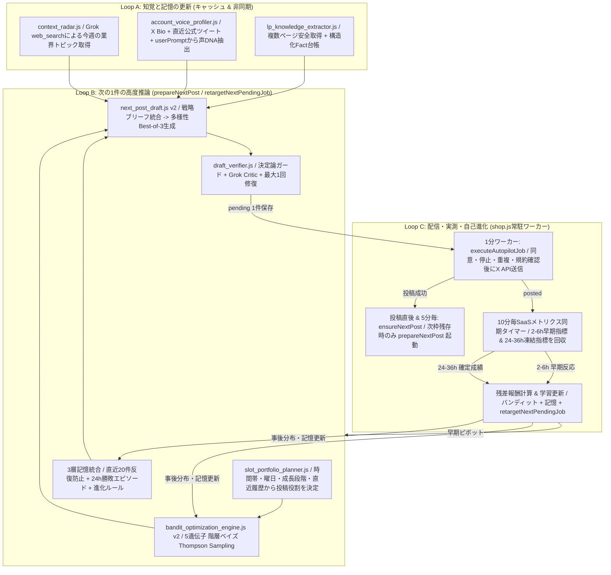

# VELOX AI v5.0 次世代自律投稿インテリジェンス 設計仕様書（Grok 実装用マスターブループリント）

> **対象システム**: `x-nurture-factory` SaaS（[src/shop.js](file:///home/songxiaj679/x-nurture-factory/src/shop.js) / [src/hybrid_saas_routes.js](file:///home/songxiaj679/x-nurture-factory/src/hybrid_saas_routes.js)）  
> **作成日**: 2026-11-18  
> **目的**: 現行の「1ページ簡易抽出 + 単発ドラフト生成 + 未接続の学習部品」から脱却し、**世界の最新AI推論工学・ベイズ強化学習・計算社会科学・認知行動科学**を統合した**実測ベースで自己進化し続ける世界最高峰のX自律投稿AI**を構築する。  
> **実装担当**: Grok（本書はそのままモジュール実装・結合・テスト可能な詳細設計書として構成）

---

## 確定アーキテクチャ決定事項（ADR: オーナー承認済み・実装時迷い禁止）

Grokは以下の4方針を確定仕様として実装すること（比較実験ホールドアウトは行わず、設計確定済みのベストプラクティスを適用する）：

1. **全運用許可アカウントへの全面適用（A/B比較無効化）**:
   - `@VeloxSystemsV4` および `@VeloxSystemsHQ` の**両アカウントに対して v5.0 の全機能を有効化**する（片方を `control_A` に留めて比較することはしない）。
   - [src/ab_experiment_engine.js](file:///home/songxiaj679/x-nurture-factory/src/ab_experiment_engine.js) 自体は既存テスト互換のため残置するが、本番呼び出し側では **`ENABLE_AB_HOLDOUT`（デフォルト `'false'`）** により全ユーザー・全アカウントへ v5.0 記憶・バンディット・検証パイプラインを適用する。
2. **X有料 (`premium`) + `advanced` 段階におけるPRリンク投稿の扱い（ベストプラクティス採用）**:
   - ~80%の通常枠（`utility_save`, `conversation_debate`, `story_observation`, `profile_asset_bridge`）では `premium` アカウントの利点を活かし、**URLなしの長い1本投稿**で滞在時間と保存率を最大化する。
   - **最大20%の `explicit_promo_offer` 枠（`growthPhase === 'advanced'` かつ `!accountState.singleOnly` 時のみ）**では、本文（`tweets[0]`）はURLなし＋先頭 `【PR】`/`[Ad]` 表記とし、**2本目のリプライ（`tweets[1]`）にのみ `targetUrl` を配置**する。そのため [src/customer_post_state.js](file:///home/songxiaj679/x-nurture-factory/src/customer_post_state.js) の `fitsAccountState(tweets, state, options)` に `{ allowPromoReply: boolean }` を追加し、`options.allowPromoReply && !state.singleOnly` の場合のみ `tweets.length === 2` を許可する。
3. **誇張・数値主張ガード（[src/post_policy_guard.js](file:///home/songxiaj679/x-nurture-factory/src/post_policy_guard.js)）の運用方針**:
   - お客様アカウントの法的・規約的安全性を最優先し、`post_policy_guard.js` の送信直前チェックは**現行の厳格基準のまま維持**する。
   - 代わりに `next_post_draft.js` v2 と `draft_verifier.js` が**生成直後に `inspectPostCompliance()` を実行**し、抵触する `%` / `倍` 表現が出た場合は料金・試用日数・手順・仕組み等の安全な具体事実へ自動修復（リライト）することで、「お客様リスクゼロ」と「送信時ジョブ失敗ゼロ」を両立する。
4. **リアルタイム文脈レーダーと匿名集合知の有効化方針**:
   - **`context_radar.js`**: **デフォルト有効 (`ENABLE_CONTEXT_RADAR !== 'false'`)** とし、TTL 8時間キャッシュ＋8秒タイムアウト＋障害時サイレントフォールバックで運用する。
   - **匿名集合知 (`collective_priors`)**: プライバシー・X規約上の安全性を最優先し、**デフォルト無効 (`ENABLE_ANONYMOUS_COLLECTIVE_PRIORS === 'true'` 時のみ有効)** としてモジュール境界だけ綺麗に実装する。初期起動から当面は各アカウント自身の階層ベイズバンディット + 声DNA + 2〜6h/24h実測ループで高速学習する。

---

## 0. エグゼクティブサマリー：なぜ今「頭脳の作り直し」が必要か

現行のSaaS本番経路（`POST /api/autopilot/launch` → `prepareNextPost` → `draftNextPostText` → `ensureNextPost`）は、過去の過剰複雑な合議パイプライン（[src/ai_deliberation_council.js](file:///home/songxiaj679/x-nurture-factory/src/ai_deliberation_council.js) 等）を整理し、「嘘・誇張・二重投稿・規約違反を防ぐ」という**安全性・誠実性の土台**を確立した。

しかし、**「賢さ（投稿の刺さり方・アカウントへの適合度・学習速度・多様性）」**という観点で実コードを精査すると、以下の**構造的ボトルネックと配線切れ**が存在する。

> [!IMPORTANT]
> 本設計の最大の発見は「LLMのプロンプトを少し書き換える」ことではない。現行コードには**既に作った学習部品が本番経路に繋がっていない断線**と、**バンディット・知覚・検証・形状整合の設計上の欠陥**が複数ある。これらを繋ぎ直し、推論時スケーリング（Inference-Time Compute Scaling）を導入するだけで、知能水準が劇的に跳ね上がる。

---

## 1. 現行コードベースの実態診断（コード根拠付き）

Grok が改修前に必ず把握すべき現行実装の事実（すべて実ファイルで確認済み）：

### 1.1 知覚・入力コンテキストの断絶
1. **お客様指示 (`userPrompt`) の未参照**
   - [src/hybrid_saas_routes.js](file:///home/songxiaj679/x-nurture-factory/src/hybrid_saas_routes.js#L1402-L1409) の `POST /api/autopilot/launch` は `req.body.userPrompt` を `saas_users/{userId}.userPrompt` に保存しているが、[src/autonomous_promo_ai.js](file:///home/songxiaj679/x-nurture-factory/src/autonomous_promo_ai.js#L2489-L2620) の `prepareNextPost` および [src/next_post_draft.js](file:///home/songxiaj679/x-nurture-factory/src/next_post_draft.js#L128-L169) の `draftNextPostText` は **`user.userPrompt` を一切読んでいない**。お客様がダッシュボードで入力したターゲット・トーン指定が「次の1投稿」に反映されない状態。
2. **アカウント固有の「生の声」が読めていない**
   - `prepareNextPost` は [src/official_api_client.js](file:///home/songxiaj679/x-nurture-factory/src/official_api_client.js#L1078-L1087) の `fetchMyAccountState`（数値と `subscriptionType` のみ）と `loadPostedJobs(userId)`（`autopilot_jobs` 履歴のみ）だけを参照している。
   - 顧客の **X Bio（自己紹介文）** や **手動投稿を含む直近のXタイムライン**（`getUserProfileAndRecentTweets`）を読んでいないため、新規顧客や直近開始顧客では `recentTexts` が空配列となり、アカウント本来の文体・専門語彙・世界観を模倣できない。
   - さらに `loadPostedJobs`（[src/autonomous_promo_ai.js](file:///home/songxiaj679/x-nurture-factory/src/autonomous_promo_ai.js#L149-L157)）は `.limit(100)` に `orderBy` がなく、投稿数が増えると「直近5件」が最新5件になる保証がない。
3. **LP理解が浅い（単一URL・2,500文字・正規表現のみ）**
   - `fetchSingleUrl`（[src/autonomous_promo_ai.js](file:///home/songxiaj679/x-nurture-factory/src/autonomous_promo_ai.js#L36-L87)）は1ページのみ取得し、`<h1-h3>` 最大8個と HTML除去後テキスト先頭 2,500文字だけを渡している。料金表・導入事例・FAQ・サブページ（`/pricing`, `/features` 等）や JSON-LD 構造化データを取りこぼし、SPA（JS描画ページ）に弱い。

### 1.2 学習ループの配線切れ・統計的欠陥
1. **メトリクス自動回収タイマーが起動していない**
   - `syncAllActiveCustomersPostMetrics()` を定期実行する `startIndependentMetricsSyncTimer` は [src/reply_promo_engine.js](file:///home/songxiaj679/x-nurture-factory/src/reply_promo_engine.js#L888-L909) に定義・export されているが、**リポジトリ内のどこからも呼び出されていない**。
   - SaaSの本番ループである `startAutopilotJobRunner`（[src/hybrid_saas_routes.js](file:///home/songxiaj679/x-nurture-factory/src/hybrid_saas_routes.js#L935-L994)）には「1分ごとの投稿ワーカー」と「5分ごとの `autoReplenishAllActiveQueues`」しかなく、手動で `/api/autopilot/sync-metrics` を押さない限り、2〜6時間後の早期指標回収・24時間スナップショット凍結・`retargetNextPendingJob` の書き直しが自動実行されない。
2. **早期スナップショット (`metricsEarlySnapshot`) の指標欠落**
   - `rememberEarly`（[src/autonomous_promo_ai.js](file:///home/songxiaj679/x-nurture-factory/src/autonomous_promo_ai.js#L2024-L2036)）は `{ impressions, bookmarks, postAgeHours, capturedAt }` のみ保存し、`replies`（および `likes`, `retweets`, `quotes`）を保存していない。一方で `deriveAngleBanditState`（[src/bandit_optimization_engine.js](file:///home/songxiaj679/x-nurture-factory/src/bandit_optimization_engine.js#L177)）は `(bookmarks + replies) / impressions` を計算しているため、早期指標では返信シグナルが常に 0 扱いになっている。
3. **既存進化モジュールとの断絶**
   - `harvestTweetMetricsAndEvolveKnowledge` は [src/episodic_memory_store.js](file:///home/songxiaj679/x-nurture-factory/src/episodic_memory_store.js)、[src/meta_prompt_optimizer.js](file:///home/songxiaj679/x-nurture-factory/src/meta_prompt_optimizer.js)、`dpoPreferencePairs`、[src/map_elites_memory.js](file:///home/songxiaj679/x-nurture-factory/src/map_elites_memory.js) を更新するが、`prepareNextPost` / `next_post_draft.js` はこれらを一切読んでいない。
4. **バンディット学習の統計的弱点（[src/bandit_optimization_engine.js](file:///home/songxiaj679/x-nurture-factory/src/bandit_optimization_engine.js)）**
   - `extractPageHypotheses` が生HTMLの行に対する単純正規表現（`向け|対象|...` × `円|価格|...`）で `who × why × proof` を作っており、ナビ文言や一般論を拾いやすい。また `CONTENT_ANGLES`（手順・トレードオフ・誤解・観察・問いかけ）が `prepareNextPost` で使われていない。
   - **インプレッション数による重み付けゼロ**: `rate = (bookmarks + replies) / impressions` を中央値で 0/1 二値化するため、**「表示3回・保存1回（33.3%）」が「表示5,000回・保存100回（2.0%）」より高い報酬として扱われる**。
   - **`pageVersion` による学習リセット**: LPの1文字更新で `pageVersionHash` が変わり、`chooseHypothesis` が `post.pageVersion === version` で完全フィルタするため、過去の学習が即ゼロに戻る。
   - **スロット孤立とコールドスタート**: 朝・昼・夕・夜・深夜が完全分離されており、スターター（1日1投稿）では統計が溜まる前に何週間もかかる。非定常性（時間減衰）もない。

### 1.3 生成品質・検証・形状整合の限界
1. **1ショット単発生成（Best-of-N 不在）**: [src/next_post_draft.js](file:///home/songxiaj679/x-nurture-factory/src/next_post_draft.js) はブリーフ1回 → 本文1回のみで、文字数不足時のみ1回再試行する。複数案生成・比較・批判・修復がない。
2. **送信時クラッシュの遅延検出**: [src/post_policy_guard.js](file:///home/songxiaj679/x-nurture-factory/src/post_policy_guard.js)（`inspectPostCompliance`）は送信直前（`executeAutopilotJob`）でのみ実行されるため、生成時に `%` や `倍` の表現が混入すると送信時刻になってからジョブが `failed` (`compliance_review_required`) で止まる。
3. **意味的重複（金太郎飴）の未検出**: [src/post_content_guard.js](file:///home/songxiaj679/x-nurture-factory/src/post_content_guard.js) は文字完全一致の SHA-256 のみ検出し、冒頭フレーズや構造・切り口の反復を止められない。
4. **`subscription === 'unknown'` の誤指示 & 制約不整合**: `next_post_draft.js`（L54）は `subscription === 'unknown'` でも「このアカウントは未課金です」と断定してプロンプトへ渡している。また [src/customer_post_state.js](file:///home/songxiaj679/x-nurture-factory/src/customer_post_state.js) の `fitsAccountState`（L69）は `writingShape(state).count === 1`（Premium等）のとき `tweets.length > 1` を無条件に拒否するため、将来 `advanced` 段階でプロモーション用2段目URL返信を付ける場合は明示的なオプション契約が必要。

---

## 2. 世界の専門分野・最新技術知見の統合フレームワーク（6つの柱）

「世界一賢いX自動投稿AI」は、**文章力が高いだけのLLM**ではない。以下の6分野の知見をソフトウェア制御アーキテクチャとして統合する。

| 分野 | 取り入れる中核知見 | VELOX AI v5.0 での具体的実装 |
| :--- | :--- | :--- |
| **1. 計算社会科学・X配信力学** | X推薦アルゴリズムは単なる「いいね」より **著者とのリプライ往復（会話深度）・ブックマーク率・滞在時間（詳細展開/ツリー完読）・引用リポスト・プロフクリック** を重視し、不自然な売り込み・毎回同型URLリプ・ミュート誘発にペナルティを課す。 | **役割ポートフォリオ配分 (`slot_portfolio_planner.js`)** と、**保存・会話・引用・リーチ驚きの複合報酬関数**。 |
| **2. 認知科学・行動経済学** | **二重過程理論（System 1 → System 2）**: TLスクロール時はSystem 1（0.3秒の反射）。「具体的な場面・違和感・未解決の緊張」でSystem 2を起動させる。**情報ギャップ理論（Loewenstein）＆ツァイガルニク効果**: 未課金2本ツリーでは1本目に「場面と問い/緊張」を置き、2本目で「仕組みと根拠」を開示する。**処理流暢性**: モバイル視認性の高い改行・リズム・AI定型句排除。 | **構造化ブリーフ設計** + **2本ツリーの情報ギャップ設計** + **AI臭（AI-Slop）検出器**。 |
| **3. ベイズ強化学習・因果推論** | **非定常（時間減衰）階層ベイズ文脈バンディット**: 少数インプレッションの偽陽性を防ぐ信頼度重み付け（Empirical Bayes Shrinkage）、フォロワー規模・時間帯による交絡を除去した**残差報酬（Residual Reward）**、複数遺伝子への分解学習。 | **5遺伝子分解型 Hierarchical Discounted Thompson Sampling (`bandit_optimization_engine.js` v2)**。 |
| **4. 最新LLM推論スケーリング** | **Test-Time Compute Scaling + Neuro-Symbolic Verification**: 1回書き捨てではなく、**構造的多様性を持つBest-of-3候補生成 → 決定論的ガード（文字数・規約・事実根拠・重複） → 校正済みCriticによる審査 → 必要時1回限りの外科的修復**。 | **`next_post_draft.js` v2 + `draft_verifier.js`**（Grok `grok-4.7` / `grok-4.3` の階層ルーティング）。 |
| **5. 階層的継続記憶・RAG** | **Working Memory（直近20件の反復抑制）** + **Episodic Memory（勝敗対比事例の非交絡検索とプロンプト注入隔離）** + **Procedural Memory（不変制約を保護した自己進化ルール）** + **Graph型LP事実台帳**。 | **`lp_knowledge_extractor.js` + `account_voice_profiler.js` + `episodic_memory_store.js` + `meta_prompt_optimizer.js` の統合接続**。 |
| **6. リアルタイム世界知覚** | 過去知識だけの投稿は「教科書的で生きている感がない」。xAI Responses API の `web_search` 等を用い、**今週ターゲット業界で実際に起きている議論・悩み**を安全に参照して「今日書く意味」を付与する（ただし未体験の捏造は厳禁）。 | **`context_radar.js`**（TTLキャッシュ付き・完全分離データ扱い・グレースフルデグレード）。 |

---

## 3. VELOX AI v5.0 全体アーキテクチャ設計

### 3.1 絶対不変のシステム境界（Grok 厳守事項）
1. **養殖側との完全分離**: `src/admin.js`, `src/setup_worker.js`, `src/batch_engine.js`, `src/reply_promo_engine.js`, `src/account_state.js`, `src/iproyal.js` 等のブラウザ操作・`auth_token` 系コードは**一切 import・参照しない**。SaaS側は公式API OAuth2（[src/official_api_client.js](file:///home/songxiaj679/x-nurture-factory/src/official_api_client.js)）と `saas_users` / `autopilot_jobs` のみ使用する。
2. **運用許可アカウント制約の維持**: [src/operated_accounts.js](file:///home/songxiaj679/x-nurture-factory/src/operated_accounts.js) の `officialApiOperationAllowed()` を、投稿・補充・プロフィール取得・メトリクス自動回収のすべてで必ず通す。
3. **誠実性・非捏造・法規/X規約準拠**:
   - ページに存在しない数値・価格・機能・体験談・成果保証を絶対に創作しない。
   - [src/growth_phase.js](file:///home/songxiaj679/x-nurture-factory/src/growth_phase.js) が `advanced` 以外のアカウントでは、自動投稿にURLやドメインを含めず、宣伝枠を作らない。
   - `isHumanOverride: true` の手動予約・手動編集ジョブをAIが勝手に上書き・削除しない。
   - Xデータの基盤モデル学習（ファインチューニング）には使わず、アカウント自身の運用コンテキスト参照のみに限定する。他顧客の生ツイート本文・秘密URLを別顧客のプロンプトへ混ぜない。

### 3.2 システム全体データフロー



---

## 4. 詳細モジュール設計（Grok 実装用インターフェース ＆ アルゴリズム仕様）

### 4.1 変更・新規ファイル一覧

| ファイル | 種別 | 役割 |
| :--- | :--- | :--- |
| `src/lp_knowledge_extractor.js` | **新規** | 同一オリジン複数ページ安全取得、JSON-LD/OG/FAQ/価格抽出、プロンプトインジェクション無害化、構造化 `brandKnowledge` 生成・キャッシュ |
| `src/account_voice_profiler.js` | **新規** | X Bio + `getUserProfileAndRecentTweets` + `userPrompt` の文体特徴量抽出（`VoiceDNA`）とステージ別スタンス生成・キャッシュ |
| `src/context_radar.js` | **新規** | Grok `web_search` を用いたターゲット市場のリアルタイム議論・悩みトピック取得（TTLキャッシュ・完全フォールバック） |
| `src/slot_portfolio_planner.js` | **新規** | 曜日 × 時間帯 × `growthPhase` × 直近履歴バランスから投稿の「役割（Portfolio Role）」とCTA方針を決定 |
| `src/draft_verifier.js` | **新規** | 決定論的ガード群（形状・禁止語・`post_policy_guard`・言語純度・n-gram新規性・数値根拠照合）＋ Grok Rubric Critic ＋ 外科的修復 |
| `src/bandit_optimization_engine.js` | **改修** | 既存API後方互換を維持した上で、**5遺伝子分解型・階層時間減衰 Thompson Sampling (`chooseGenesForPost`, `computeDeconfoundedRewards`)** を実装 |
| `src/next_post_draft.js` | **改修** | **戦略ブリーフ統合 → 多様性Best-of-3生成 → `draft_verifier` 審査・修復** へアップグレード。`userPrompt` 最優先反映を実装 |
| `src/customer_post_state.js` | **改修** | `subscription === 'unknown'` の説明文修正、および `fitsAccountState(tweets, state, { allowPromoReply })` の安全な明示的サポート |
| `src/autonomous_promo_ai.js` | **改修** | `prepareNextPost` が上記知覚・記憶・バンディット・検証を一気通貫接続。`loadPostedJobs` を最新順取得化、`rememberEarly` に全指標記録、`retargetNextPendingJob` にピボット/深掘り判定を追加 |
| `src/hybrid_saas_routes.js` | **改修** | `startAutopilotJobRunner` に SaaS用メトリクス回収・進化タイマー（10分周期）を組み込み |
| `src/metrics_harvest_engine.js` | **改修** | 24h凍結・2〜6h早期の正規化拡張に加え、フォロワー規模・時間帯による交絡を除いた**残差報酬（Residual Reward）計算純粋関数**と、2–6h早期窓対応の同期判定を追加 |
| `src/official_api_client.js` | **改修** | `getUserProfileAndRecentTweets` にBio (`description`) 返却および任意 `includeNonPublicMetrics`（400時安全フォールバック）対応を追加 |
| `src/grok_client.js` | **改修** | `completeText` / `completeJson` への `systemPrompt` 分離対応と、タイムアウト・構造化JSON抽出の堅牢化 |

---

### 4.2 Module 1: 深いLP知覚エンジン (`src/lp_knowledge_extractor.js`)

#### エクスポート契約
```javascript
/**
 * @param {string} targetUrl
 * @param {{ db?, userId?, cachedKnowledge?, forceRefresh?, now? }} options
 * @returns {Promise<{ ok: boolean, pageSummary: object, brandKnowledge: object|null, fromCache: boolean, error?: string }>}
 */
async function extractBrandKnowledge(targetUrl, options = {}) {}
function sanitizeExternalText(rawText) {}
function filterGroundedNumbers(candidateNumbers, rawCorpusText) {}
```

#### 詳細仕様
1. **エントリページ + 同一オリジン高信号サブページ探索**:
   - すべてのHTTP取得は必ず [src/url_fetch_guard.js](file:///home/songxiaj679/x-nurture-factory/src/url_fetch_guard.js) の `fetchPublicText()` を経由する（SSRF防御・内部IP遮断・リダイレクト3回・512KB上限を継承）。
   - エントリHTMLから `<a href="...">` を抽出し、**同一オリジン (`new URL(href, entryUrl).origin === entryOrigin`)** かつパスまたはリンクテキストが `/pricing|price|plan|features?|product|about|faq|case|doc|料金|機能|特徴|事例|よくある質問/i` に合致するURLを**最大2ページ**追加取得する（各タイムアウト 8,000ms、失敗時は無視して続行）。
2. **HTMLパーシングとプロンプトインジェクション隔離**:
   - `<script type="application/ld+json">` から JSON-LD を安全抽出（`JSON.parse` 例外は無視）。
   - `<meta property="og:*">`, `<meta name="description">`, `<title>`, `<h1..h3>`, `<li>`, `<table>` を抽出し、`<nav>`, `<footer>`, `<header>`, `<script>`, `<style>`, `<noscript>`, `<svg>` を除去。
   - **インジェクション無害化 (`sanitizeExternalText`)**: `"ignore previous instructions"`, `"disregard all prior"`, `"system:"`, `"assistant:"`, `"以下の指示を無視"`, `"システムプロンプト"` 等のパターンを `[REDACTED_DIRECTIVE]` へ置換。
   - 結合テキストから `contentHash = pageVersionHash(...)` を計算。互換用 `pageSummary`（`{ ok, url, title, description, headings, snippet, pageVersion }`）も常に返すため、既存コードは一切壊れない。
3. **LLMによる構造化 Fact Ledger 抽出（`contentHash` 一致 ＆ 7日以内ならキャッシュ即返却）**:
   - 未キャッシュ時のみ `grok_client.completeJson({ tier: 'quality', systemPrompt, prompt, timeoutMs: 45000 })` を呼び出す。
   - **出力JSONスキーマ**:
     ```json
     {
       "productName": "サービス正式名",
       "category": "B2B SaaS / 開発ツール / コンサル 等",
       "oneLineMechanism": "何がどう動くか（誇張なしの機構説明）",
       "icpSummary": "ページ記載に基づく想定読者像",
       "verifiedClaims": [
         {
           "claimId": "clm_xxxx",
           "semanticKey": "snake_case_semantic_slug",
           "audience": "誰に（記載無ければ空文字）",
           "painScene": "どの業務場面・課題か",
           "mechanism": "どの仕組みで解くか",
           "proofQuote": "ページ原文に含まれる根拠抜粋（80字以内）",
           "verifiedNumbers": ["ページ内に実在する数値・価格・単位のみ"]
         }
       ],
       "verifiedPricing": ["ページに記載された料金事実のみ"],
       "verifiedConstraints": ["できないこと・免責・対象外条件"],
       "terminology": ["対象業界の顧客が使う実務語彙（最大12個）"]
     }
     ```
   - **`filterGroundedNumbers`（決定論的検証）**: 抽出された各数値トークン（例: `¥9,800`, `14日`, `3001`）が取得した生テキスト（NFKC正規化後）に実在するか検査し、**原文に無い数値は削除**する。
   - LLM失敗・XAIキー不在時は決定論的フォールバック（`extractPageHypotheses` 相当の段落から `verifiedClaims` を構築）を返し、処理を止めない。

---

### 4.3 Module 2: アカウント「声のDNA」プロファイラー (`src/account_voice_profiler.js`)

#### エクスポート契約
```javascript
/**
 * @param {{ userId: string, user: object, creds?: object, accountState: object, recentPostedJobs?: Array, now?: Date }} params
 * @returns {Promise<object>} voiceProfile (VoiceDNA)
 */
async function resolveAccountVoiceProfile(params) {}
function measureStylometry(texts, lang = 'ja') {}
```

#### 詳細仕様
1. **キャッシュ判定**: `user.voiceProfile` が存在し、`extractedAt` が **12時間以内** かつ `userPromptHash`（`user.userPrompt` のハッシュ）が一致し、`xUsername` が一致していれば API・LLM 呼び出しをスキップして即返却する。
2. **オリジナルツイート収集**:
   - `creds` があれば `getUserProfileAndRecentTweets(creds, 20)` を呼び出す（`official_api_client.js` の `verifyOfficialCredentials` 返却に `user.description` (Bio) を含めるよう拡張する）。
   - `RT @` で始まるリポスト、および `@` で始まる他者宛リプライを除外し、本人のオリジナル発信のみ抽出（不足時は `recentPostedJobs` の本文を補助使用）。
   - API取得失敗時はエラーで止めず、`user.userPrompt` + `recentPostedJobs` + `accountState` から縮退構築する。
3. **定量的文体計測 (`measureStylometry`)**:
   - `avgCharLength`, `avgLineBreaks`, `usesPeriodAtEnd`（文末に `。` を使うか）, `exclamationRate`, `emojiPolicy` (`'none'` if 絵文字出現率 < 0.05 else `'minimal'`), `hashtagPolicy` (`'zero'` if ハッシュタグ出現率 < 0.1 else `'minimal'`)。
4. **ステージ別等身大スタンス (`stagePosture`)**:
   - `followers === null || followers < 100`: `peer_builder`（等身大の現場実践者・検証者。上から目線の断定・説教・インフルエンサー気取りを禁止）
   - `100 <= followers < 5000`: `practitioner_specialist`（実務構造を言語化する専門実践者）
   - `followers >= 5000`: `category_authority`（一次観察と本質的視座を示す業界実践者）
5. **定性的VoiceDNA抽出**:
   - オリジナルツイートが 3件以上あるか `user.userPrompt` がある場合、`grok_client.completeJson({ tier: 'nurture' })` で `{ register, firstPerson, signatureTopics, antiPatterns, voiceSummary, sampleHooks }` を抽出し Firestore `saas_users/{userId}.voiceProfile` へ merge 保存（12hキャッシュ）。

---

### 4.4 Module 3: リアルタイム文脈レーダー (`src/context_radar.js`)

#### エクスポート契約
```javascript
/**
 * @param {{ category: string, icpSummary: string, terminology: string[], lang: 'ja'|'en', cachedRadar?: object, now?: Date }} params
 * @returns {Promise<{ signals: Array<{ topic: string, pain: string, angleHint: string }>, fetchedAt: string, expiresAt: string } | null>}
 */
async function fetchSituationalContext(params) {}
```

#### 詳細仕様
- 環境変数 `ENABLE_CONTEXT_RADAR` が `'false'` の場合、または `hasXaiKey()` が `false` の場合は即 `null` を返す。
- `cachedRadar` の `expiresAt > now` かつ `queryKey` 一致ならキャッシュを即返却（TTL: **8時間**）。
- 未キャッシュ時は `grok_client.completeText({ search: true, timeoutMs: 8000 })` を呼び、「この業界（`category`, `icpSummary`）のターゲット読者が今週実務で直面しやすい具体的論点・疑問を最大3件、JSON配列のみで返す。架空ニュース・未確認数値は禁止」と指示する。
- 失敗時・タイムアウト時は警告ログのみ残し `null` を返す（投稿生成を絶対に止めない）。

---

### 4.5 Module 4: 役割ポートフォリオ・プランナー (`src/slot_portfolio_planner.js`)

#### エクスポート契約
```javascript
/**
 * @param {{ growthPhase: 'trust'|'advanced'|'unknown', timeSlot: string, dayOfWeek: number, recentPostedJobs: Array, userPrompt?: string, accountState: object }} params
 * @returns {{ portfolioRole: string, allowPromoUrl: boolean, requireDisclosure: boolean, preferredFormats: string[], allowedCtaModes: string[], rationale: string }}
 */
function planSlotPortfolio(params) {}
```

#### 5役割の定義と配分ルール
1. **`utility_save`**（保存最大化：手順・チェックリスト・判断基準）
2. **`conversation_debate`**（会話/引用RT最大化：トレードオフ・誤解・問いかけ）
3. **`story_observation`**（信頼共感：LPの想定シーンに根ざした現場観察）
4. **`profile_asset_bridge`**（プロフ固定誘導：URLを出さず思考の深さで興味を引く）
5. **`explicit_promo_offer`**（明示PRオファー：**`growthPhase === 'advanced'` かつ直近4投稿に `explicit_promo_offer` が0件、かつ `timeSlot` が `evening` / `noon` / Starterの `morning` の場合のみ解放**）

#### 配分アルゴリズム（決定論的）
- 直近1件と同一 `portfolioRole` を禁止。直近3件中の出現回数にペナルティ。
- 時間帯・曜日（`dayOfWeek` 0=日曜〜6=土曜）ごとの親和性スコアを加算（例：月曜朝は実践準備の `utility_save`、金曜夜や日曜夜は内省・振り返りの `story_observation` / `conversation_debate`）。
- `userPrompt` に「PR禁止 / 宣伝なし / 認知重視」等の語があれば `explicit_promo_offer` の重みを 0 にし、「リード獲得 / 案内を増やす」等があれば（`growthPhase === 'advanced'` の範囲内で）重みを上げる。
- **重要（`customer_post_state.js` 整合）**:
  - `explicit_promo_offer` が選ばれ `allowPromoUrl === true` の場合のみ、`tweets[1]`（2本目リプライ）に `【PR】詳細はこちら: ${targetUrl}`（EN: `[Ad] Details: ${targetUrl}`）を置く契約とし、`customer_post_state.js` の `fitsAccountState(tweets, state, { allowPromoReply: true })` が `state.singleOnly` でない限り 2本目（本文 + URLリプライ）を許可する。`growthPhase !== 'advanced'` では `allowPromoUrl` は常に `false`。

---

### 4.6 Module 5: 5遺伝子・階層時間減衰ベイズバンディット (`src/bandit_optimization_engine.js` v2)

既存の関数群（`sampleBetaDistribution`, `selectActionViaThompsonSampling`, `updateBanditState`, `deriveAngleBanditState`, `extractPageHypotheses`, `chooseHypothesis`, `formatHypothesis`, `pageVersionHash`）は**既存テスト互換のため完全に保持**し、以下を新規追加・エクスポートする。

#### エクスポート契約
```javascript
const GENE_SPACES = Object.freeze({
  angle: ['practical_steps', 'tradeoffs', 'misconception', 'field_observation', 'reflective_question', 'contrarian_evidence', 'checklist_framework'],
  hookType: ['scene_trigger', 'specific_artifact', 'counter_intuitive', 'direct_question', 'observation_lead', 'problem_reframe'],
  formatSingle: ['micro_punch', 'structured_breakdown', 'narrative_insight'],
  formatThread: ['scene_then_mechanism', 'myth_then_reality'],
  ctaMode: ['zero_cta', 'open_question', 'bookmark_anchor', 'soft_offer_mention', 'explicit_pr_reply']
});

function computeDeconfoundedRewards(posts) {}
function chooseGenesForPost({ posts, brandKnowledge, portfolioPlan, accountState, timeSlot, random = Math.random }) {}
```

#### 数理仕様（Grok がそのまま実装できる純粋関数）
1. **対象スナップショット選択**:
   - 各投稿 `post` から、凍結済み `metrics24hSnapshot`（`isFrozen === true`, `impressions > 0`）を重み `1.0` で取得。
   - 無ければ有効な `metricsEarlySnapshot`（`impressions >= 20`, `postAgeHours >= 2`）を重み `0.45` で補助採用。
2. **多指標複合レート ($R_i$)**:
   $$S_i = 4.0 \cdot \text{bookmarks}_i + 3.5 \cdot \text{replies}_i + 3.0 \cdot \text{quotes}_i + 2.0 \cdot \text{retweets}_i + 0.5 \cdot \text{likes}_i$$
   $$R_i = \frac{S_i}{\max(\text{impressions}_i, 1)}$$
3. **インプレッション信頼度重み ($w_i$) ＆ リーチ驚き係数 ($M_i$)**:
   - 投稿 $i$ より前の有効投稿のインプレッション中央値（最小20、未蓄積時は全体中央値または50）を $\mu_{\text{imp}, i}$ とする：
   $$w_i = \frac{\text{impressions}_i}{\text{impressions}_i + \max(50,\ 0.25 \cdot \mu_{\text{imp}, i})} \cdot \text{snapshotWeight}_i$$
   $$M_i = \operatorname{clamp}\left(\log_2\left(1 + \frac{\text{impressions}_i}{\max(\mu_{\text{imp}, i}, 20)}\right),\ 0.30,\ 1.80\right), \qquad P_i = R_i \cdot M_i$$
4. **時間減衰・階層事後分布更新**:
   - 投稿を時系列昇順で走査し、各次元の全候補キーの事前分布を $(\alpha_0 = 1.5, \beta_0 = 1.5)$ で初期化。
   - 各ステップで既存増分に時間減衰 $\gamma = 0.94$ を乗じた後、直前までの移動中央値 $\hat{P}_{\text{base}}$ と MAD（中央絶対偏差）からソフト成功確率を算出：
   $$y_i = \frac{1}{1 + \exp\left(-1.5 \cdot \frac{P_i - \hat{P}_{\text{base}}}{\max(\text{MAD},\ 0.005)}\right)}$$
   - 該当投稿の遺伝子 `g`（`claimSemanticKey`, `angle`, `hookType`, `format`, `ctaMode`）へ加算：
     - アカウント全体事後分布: $\alpha^{\text{acct}}_g \leftarrow \gamma \alpha^{\text{acct}}_g + w_i y_i,\quad \beta^{\text{acct}}_g \leftarrow \gamma \beta^{\text{acct}}_g + w_i (1 - y_i)$
     - スロット別増分 (`post.timeSlot === targetTimeSlot` のみ): $\Delta\alpha^{\text{slot}}_g, \Delta\beta^{\text{slot}}_g$ も同様に減衰加算。
   - **選択時サンプリング**:
     - `sampleBetaDistribution(alpha0 + acctDeltaAlpha + slotDeltaAlpha, beta0 + acctDeltaBeta + slotDeltaBeta, random)` を各許可候補について計算。
     - **反復クールダウン**: 直近2投稿連続で使用された `hookType` / `angle` / `claimSemanticKey` はサンプル値に `0.65`（直前1件と同じなら `0.75`）を掛けて探索多様性を強制する（候補が1件しかない場合は無適用）。

---

### 4.7 Module 6: 推論時スケーリング生成・検証エンジン (`src/next_post_draft.js` v2 + `src/draft_verifier.js`)

#### 4.7.1 `next_post_draft.js` v2 パイプライン
```javascript
async function draftNextPostText({
  lang = 'ja',
  accountState,
  hypothesisText,      // 後方互換維持
  pageSummary,
  brandKnowledge = null,
  voiceProfile = null,
  userPrompt = '',
  genes = null,
  portfolioPlan = null,
  episodicContext = '',
  promptDirectives = [],
  contextSignals = null,
  recentPosts = [],    // 直近最大20件のテキスト（Working Memory）
  recentTexts = [],    // 後方互換
  retargetContext = null // 早期ピボット/深掘り時の理由
})
```
1. **Call 1 (`synthesizeBrief`, `grok-4.7` JSON)**:
   - `systemPrompt`: 不変制約（創作禁止、機能列挙禁止、`userPrompt` 最優先、`stagePosture` 背伸び厳禁、文字数・本数制約、AI臭禁止ワード）。
   - `user` ペイロード: `brandKnowledge` の該当 `claim` + `verifiedConstraints`、`voiceProfile`（`register`, `firstPerson`, `quantMetrics`, `sampleHooks`）、`userPrompt`、選択された `genes` & `portfolioPlan`、`episodicContext`（勝敗各1件の引用データ）、`promptDirectives`（`userPrompt` と矛盾しないもの）、`contextSignals`（任意）、`recentPosts` から抽出した禁止・重複回避フレーズ（Working Memory Cooldown）。
   - 出力 JSON: `{ offer, reader, scene, voiceDirective, onePoint, threadBridge, avoidList, citedClaimId, allowedNumbers }`。
2. **Call 2 (`generateCandidates`, `grok-4.7` JSON)**:
   - 1回のAPIコールで**構造が異なる3案**を生成：
     - `candidate_a`: 推奨遺伝子（`angle × hookType × format`）に忠実な案
     - `candidate_b`: 冒頭フックをより具体的・短く鋭く切り直した対抗案
     - `candidate_c`: 保存価値（チェックリスト/対比）または返信余白を強めた案
   - 形式制約:
     - `portfolioPlan.allowPromoUrl === true` の場合：本文（`tweets[0]`）にはURLを入れず、`tweets` は本文のみ（または本文1本）を生成させ、**`【PR】` / `[Ad]` プレフィックスおよび 2段目リプライ `${disclosure}詳細はこちら: ${targetUrl}` はプログラム側で決定論的に合成**する（LLMにURLを書かせないことでURL改変事故を根絶）。
     - `accountState.subscription === 'unknown'` 時も「未課金」と断定せず、「1投稿の文字数上限が短いため、2本のツリーで1本目に場面・2本目に提供内容を書く」と指示する。
3. **Step 3: `draft_verifier.js` による検証・ランキング・修復**:
   - 各候補を `runDeterministicAudit(candidate, context)` に通す：
     - `fitsAccountState`（`micro_punch` 選択時の最小文字数は `45`、通常単発 `70`、ツリー各本 `20`）
     - `assertPostThreadUnambiguous`（[src/post_constraint_guard.js](file:///home/songxiaj679/x-nurture-factory/src/post_constraint_guard.js)）
     - `inspectPostCompliance`（[src/post_policy_guard.js](file:///home/songxiaj679/x-nurture-factory/src/post_policy_guard.js) — 保存前チェック！）
     - `lang === 'en'` 時の `containsJapaneseScript` 遮断
     - **AI-Slop ブラックリスト検査**: `いかがでしたでしょうか`, `必見です`, `〜について解説します`, `ゲームチェンジャー`, `すべて`, `大幅に`, `安全に`, `戦略的`, `game-changer`, `unlock the power`, `delve into`, `in today's fast-paced` 等を検出
     - **Working Memory 意味的新規性 (`computeMaxSimilarity`)**: 直近20投稿との文字3-gram（JA）/ 単語2-gram（EN）Jaccard 類似度が `>= 0.38`、または冒頭フック類似度 `>= 0.55` でリジェクト
     - **数値ハルシネーション検査 (`verifyNumericGrounding`)**: 下書き内の数値表現が `brandKnowledge.verifiedNumbers ∪ userPromptNumbers ∪ accountStateNumbers ∪ 順序番号(1., 2., 3.)` に含まれない場合は `ungrounded_number` としてリジェクト
   - ハードゲート通過候補が 2件以上ある場合、`scoreCandidatesWithCritic`（`grok-4.3` `nurture` tier JSON）で6軸採点（計100点）し最高スコア案を採用。
   - **Step 4: 外科的修復（最大1回）**:
     - ハードゲートを通過した候補が 0件、または最高スコア < 72点の場合、失敗理由（例: `ungrounded_number: "80%"`, `too_similar_to_recent`, `compliance: claim_needs_evidence`, `hook_too_abstract`）を明示して 1回だけ修復生成を行い、再度決定論的ゲートを強制する。修復後もハードゲートに通らない場合は `PostConstraintError` 等で安全に停止（Fail-Closed）。

---

### 4.8 Module 7: 閉ループメトリクス回収・早期ピボット・継続学習

1. **SaaS用メトリクス自動同期タイマーの組み込み ([src/hybrid_saas_routes.js](file:///home/songxiaj679/x-nurture-factory/src/hybrid_saas_routes.js))**:
   - `startAutopilotJobRunner()` 内に、10分周期（起動30秒後に初回実行）の `runSaasMetricsSyncCycle()` を追加する（`runWorker === true` 時のみ稼働）。
   - [src/official_api_client.js](file:///home/songxiaj679/x-nurture-factory/src/official_api_client.js) の `syncAllActiveCustomersPostMetrics()` を呼び出す（内部で `officialApiOperationAllowed()` をチェック済み、かつ [src/user_sync_mutex.js](file:///home/songxiaj679/x-nurture-factory/src/user_sync_mutex.js) で排他制御済み）。
   - [src/metrics_harvest_engine.js](file:///home/songxiaj679/x-nurture-factory/src/metrics_harvest_engine.js) の `evaluateUserSyncEligibility` を拡張し、**`2.0h <= age <= 6.0h` かつ `!metricsEarlySnapshot` の投稿がある場合も `urgent_early_window` としてクールダウンをバイパス**、通常クールダウンは `180分` に調整して X API レート制限を保全する。
2. **`rememberEarly` の全指標保存 ([src/autonomous_promo_ai.js](file:///home/songxiaj679/x-nurture-factory/src/autonomous_promo_ai.js))**:
   - `metricsEarlySnapshot` に `{ impressions, bookmarks, replies, likes, retweets, quotes, postAgeHours, capturedAt }` をすべて保存する。
3. **`retargetNextPendingJob` の3分岐高度化 ([src/autonomous_promo_ai.js](file:///home/songxiaj679/x-nurture-factory/src/autonomous_promo_ai.js))**:
   - `metricsEarlySnapshot` 新規取得時、アカウントの過去投稿の早期反応分布から `velocityZScore` を算出：
     - `deepen_winner`（Breakout: `z >= +1.0` かつ `impressions >= 100`）: 直近投稿の `claimSemanticKey` を活かしつつ**異なる `angle` / `hookType`**（例：続編的視点や具体的手順・問いかけ）へ書き直す。
     - `pivot_angle`（Stall: `z <= -0.8` または `age >= 4h && impressions < 30 && bookmarks === 0`）: `bandit_optimization_engine.js` の更新済み分布から**直近投稿とは別の `angle` × `hookType` × `claimSemanticKey`** を選んで書き直す。
     - `keep`: 通常範囲なら既存 `pending` ジョブをそのまま維持（LLM呼び出し節約）。
   - **トランザクション保護**: `retargetNextPendingJob` は `db.runTransaction` で対象 `pending` ジョブが今も `status === 'pending'`、かつ `!isHumanOverride`、かつ `scheduledAt > now + 5分` であることを確認してから更新し、1分投稿ワーカーとの競合を根絶する。

---

### 4.9 Module 8: 世界最高水準への追加ブラッシュアップ（v5.1 高度知能・自己防衛・連続性仕様）

v5.0 の中核設計に加え、実コードの死角を完全に塞ぎ、人間のトップ運用者を超えるための **7+1 の高度知能仕様** を組み込む：

1. **`reThinkSingleJob` の旧合議バイパス解消 ([src/autonomous_promo_ai.js](file:///home/songxiaj679/x-nurture-factory/src/autonomous_promo_ai.js#L1564))**:
   - 現行ではダッシュボードからの個別再推敲（`POST /api/autopilot/jobs/:jobId/re-think`）が旧7名合議プロンプト（「120〜140文字」固定）を通るため、`VoiceDNA` や `brandKnowledge` や `customer_post_state` が無視される。
   - **改修**: `reThinkSingleJob` を `next_post_draft.js` v2 + `draft_verifier.js` へ統合し、`previousDraft: job.tweets` と `rethinkFeedback: promptText` を最優先指示として渡して再執筆・検証する。
2. **受動メンション・質問リスニングによる「読者ドリブン編集ループ」**:
   - 自動返信・自動フォローは X 事前承認まで停止中のままとし、**読み取り専用（Read-Only）** で [src/official_api_client.js](file:///home/songxiaj679/x-nurture-factory/src/official_api_client.js#L814) の `getOfficialMentions(creds, 10)` をメトリクス同期時（TTL 12時間）に参照する。
   - 自社投稿への読者からの質問・反論・関心の傾向をインジェクション無害化・匿名抽象化して `saas_users/{userId}.audienceQuestionsCache` に保存し、`synthesizeBrief` へ注入する（「昨日リプ欄で多かった疑問に答える投稿」が自律的に生まれる）。
3. **複数日にまたがる物語連続性 (`Narrative Arc Continuity`)**:
   - Working Memory に `topicArc`（直近3投稿の `claimSemanticKey`, `angle`, `onePoint`）を保持する。
   - 直近投稿が `Breakout` (`deepen_winner`) した場合は「単発の無関係投稿」に戻さず、自然な続編（例：「昨日の論点に関連して、実務で次に詰まりやすい点」）として連続展開を許可し、2回連続後は意図的に別テーマへローテーションさせる。
4. **公式APIメトリクスによる「アルゴリズム減衰・異常自己防衛モード (`Algorithm Recovery Mode`)」**:
   - 現行 `customer_post_state.js` の `searchIndexLevel` はSaaS単体運用では更新されないため、公式APIの `public_metrics` のみから **7日間ローリング到達率 (`reachRatio = impressions / max(followers, 20)`)** を監視する。
   - 成熟投稿3件連続で直近中央値の **15%未満** に急落した場合、`slot_portfolio_planner.js` を自動的に **`recoveryMode`** へ切り替え、PR・リンク・ハッシュタグを全面停止して `conversation_debate` と `micro_punch`（純粋な会話・共感）のみに絞り、リーチ回復まで安全運転する。
5. **人間らしい投稿時刻の揺らぎ (`Humanlike Slot Jitter`) ＆ 時間帯歩留まり学習**:
   - 現行 `prepareNextPost`（`autonomous_promo_ai.js` L2549）は常に `:30` または `:00` 固定で送信予約しており機械的である。
   - **改修**: ジョブ生成時に `-6分 〜 +13分` の決定論的/疑似ランダム揺らぎ（必ず `now + 15分` 以降かつ同枠内）を付与し、同時に `postedHourLocal` を記録して、アカウントごとに反応が出やすい実運用時刻帯を `weekly_growth_report.js` で可視化する。
6. **Grok → Gemini 自動フェイルオーバー ＆ トークン/コスト観測性 ([src/grok_client.js](file:///home/songxiaj679/x-nurture-factory/src/grok_client.js))**:
   - 現行 `next_post_draft.js` は `hasXaiKey()` が `true` のときに Grok API が 429/5xx/タイムアウトすると、`GEMINI_API_KEY` があってもフォールバックせず失敗する。
   - **改修**: Grok 側の一時的障害（429/5xx/Timeout）時は `GEMINI_API_KEY`（`gemini-3.8-flash`）へ自動フェイルオーバーするラッパーを設け、使用モデル・呼び出し回数・所要時間・失敗理由を `autopilot_jobs.qualityAudit` へ記録して 99.9% 以上の生成稼働率と原価可視性を確保する。
7. **`trustGoalMet` の自動通知・任意自動アンロック ([src/growth_phase.js](file:///home/songxiaj679/x-nurture-factory/src/growth_phase.js))**:
   - `harvestTweetMetricsAndEvolveKnowledge` でフォロワー100人または24〜36h表示1,000回達成を検知した際、`saas_users.trustGoalMetAt` を自動記録してダッシュボード上で解禁案内を強調表示する（加えて `user.autoUnlockPromoOnGoalMet === true` 設定時のみ自動アンロックを許可する拡張余地を持たせる）。
8. **将来拡張 Phase 6: 構造化ビジュアルカード自動添付 (`mediaIds` 活用)**:
   - [src/official_api_client.js](file:///home/songxiaj679/x-nurture-factory/src/official_api_client.js#L326) の `postOfficialTweet(..., mediaIds = [])` は既にメディア添付口を持つ。将来 X OAuth2 スコープへ `media.write` と X Media Upload v2 エンドポイントを追加する際、`structured_breakdown`（チェックリスト・比較表）投稿に限り `brandKnowledge` の根拠文言のみを使ったクリーンな図解カード画像を生成・添付できる拡張インターフェースを予約する。

---

## 5. Firestore データ設計 ＆ クエリ安全性

### 5.1 追加されるフィールド（すべて後方互換・非破壊）
- `saas_users/{userId}`: `brandKnowledge`, `voiceProfile`, `contextRadarCache`, `audienceQuestionsCache`, `banditState`, `algorithmRecovery`, `trustGoalMetAt`
- `autopilot_jobs/{jobId}`: `aiVersion`, `genes`, `briefSummary`, `qualityAudit`, `earlyVelocity`, `rewardMetrics`, `postedHourLocal`

### 5.2 インデックスエラー回避ルール（本番環境 403対策）
- `loadPostedJobs(userId)` 等の新規・改修クエリでは、未配備の複合インデックスに依存して 500エラーを起こさないよう、単一 `where('userId', '==', userId).where('status', '==', 'posted').limit(200)` で取得してメモリ内で `postedAt` 降順ソートを行う（または `orderBy('postedAt', 'desc')` を試み、`isFirestoreIndexError(err)` 時にメモリソートへ自動フォールバックする）。

---

## 6. LLMモデル運用・コスト最適化・セキュリティ設計

1. **システムプロンプトと非信頼データの分離**: `grok_client.js` に `systemPrompt` 分離を追加し、`role: 'system'` に不変ルール、`role: 'user'` に外部LPデータや過去投稿を置くことでプロンプトインジェクションを遮断する。
2. **1投稿あたりのLLMコール最適化**:
   - キャッシュウォーム時は **2〜3コール**（Brief統合 `grok-4.7` + Best-of-3生成 `grok-4.7` + 条件付きCritic `grok-4.3`）。修復はハードゲート落ち/低スコア時のみ最大1回。
3. **`post_policy_guard.js` との協調**:
   - 送信直前の `inspectPostCompliance` は最終安全砦として維持しつつ、`draft_verifier.js` 側で生成直後に同検査を実行することで送信時ジョブ失敗を防止する。

---

## 7. 段階的実装ロードマップ（Grok 作業手順）

### Phase 1: 配線切れ修復 ＆ 最重要バグ修正（リスク極小・即効性大）
1. `prepareNextPost` と `draftNextPostText` に `user.userPrompt` を接続（最優先制約として反映）。
2. `loadPostedJobs` を最新順ソート化（`postedAt` 降順、インデックス安全なメモリソート）。
3. `rememberEarly` に `replies`, `likes`, `retweets`, `quotes` を追加保存。
4. `startAutopilotJobRunner` (`src/hybrid_saas_routes.js`) に 10分周期の `syncAllActiveCustomersPostMetrics` タイマーを組み込み（`metrics_harvest_engine.js` に 2–6h 早期窓を追加）。
5. `next_post_draft.js` / `customer_post_state.js` の `subscription === 'unknown'` 文言修正とテスト追加。

### Phase 2: 深いLP知覚 ＆ アカウント「声のDNA」実装
1. `src/grok_client.js` の `systemPrompt` 分離対応。
2. `src/lp_knowledge_extractor.js` 新規実装（最大3ページ安全取得、JSON-LD/OG/価格表抽出、プロンプトインジェクション無害化、数値原文照合、7日TTLキャッシュ）。
3. `src/account_voice_profiler.js` 新規実装（`official_api_client.js` の Bio 返却追加 + 直近オリジナル20件解析 + ステージ別姿勢 + 12hキャッシュ）。
4. `prepareNextPost` への統合 + SSRF/数値ハルシネーション遮断テスト追加。

### Phase 3: Best-of-3 生成 ＆ Neuro-Symbolic 検証・修復パイプライン
1. `src/slot_portfolio_planner.js` 新規実装（曜日 × 時間帯 × `growthPhase` × 履歴バランス、`advanced` 時のみ条件付き `explicit_promo_offer` 許可）。
2. `src/draft_verifier.js` 新規実装（決定論ハードゲート + AI-Slop検出 + 3-gram/2-gram Jaccard 重複検出 + 数値根拠照合 + Grok Critic + 最大1回外科的修復）。
3. `src/next_post_draft.js` v2 実装（3層記憶統合 + Best-of-3 構造多様性生成 + `draft_verifier` 接続）。
4. `retargetNextPendingJob` も新パイプラインを共用するよう統一。

### Phase 4: 5遺伝子バンディット ＆ 早期ベロシティ・ピボット学習
1. `src/metrics_harvest_engine.js` へ複合スコア・信頼度重み $w_i$・リーチ驚き係数 $M_i$・残差報酬計算関数を追加。
2. `src/bandit_optimization_engine.js` v2 実装（5遺伝子階層時間減衰 Thompson Sampling、既存関数の後方互換テスト全維持）。
3. `retargetNextPendingJob` の 3分岐（`keep` / `deepen_winner` / `pivot_angle`）とトランザクション保護。
4. `src/weekly_growth_report.js` へ遺伝子別24h集計サマリー追加（因果断定しない記述的表記）。

### Phase 5: リアルタイム文脈レーダー ＆ 全アカウント有効化・UI可視化・追加知能統合
1. `src/context_radar.js` 新規実装（`grok_client` `web_search` + TTL 8hキャッシュ + 8秒タイムアウト耐障害フォールバック、デフォルト有効 `ENABLE_CONTEXT_RADAR !== 'false'`）。
2. `@VeloxSystemsV4` と `@VeloxSystemsHQ` の両方へ v5.0 全機能を有効化（`ENABLE_AB_HOLDOUT='false'` をデフォルトとし、比較ホールドアウトを行わない。`src/ab_experiment_engine.js` はテスト互換のため残置）。
3. `reThinkSingleJob` の v5.0/v5.1 パイプライン統合、受動メンション質問リスニング（Read-Only）、`Algorithm Recovery Mode`、スロット時刻揺らぎ、Grok→Gemini 自動フェイルオーバー、`trustGoalMetAt` 記録を実装。
4. `views/dashboard_view.html` への `genes.portfolioRole` / `customerReason` / 実測根拠 / 信用目標達成通知の可視化追加。
5. 匿名集合知事前分布（`collective_priors/v1`）の境界モジュールを `ENABLE_ANONYMOUS_COLLECTIVE_PRIORS === 'true'` のフィーチャーフラグ付き（デフォルト無効）で実装。

### Phase 6（将来拡張・OAuthスコープ追加後）: ビジュアルカード自動添付
1. X OAuth2 スコープへ `media.write` 追加・実Xメディアアップロード疎通検証後、`structured_breakdown` 投稿に `brandKnowledge` の検証済み事実のみからレンダリングした図解カード画像を `mediaIds` 経由で自動添付。

---

## 8. 品質保証・テスト・オフライン評価基準

Grok は各フェーズ完了時に `npm test`（`NODE_ENV=test node --test`）を全件パスさせ、さらに以下の新規ユニットテストおよびベンチマーク（`scripts/eval_velox_ai.js`）を追加すること：
- **ハード制約遵守率**（文字数・形状・URL位置・言語純度・`post_policy_guard`）: **100%**
- **未検証数値ハルシネーション率**: **0%**
- **連続10投稿生成時の 3-gram Jaccard 最大重複率**: **< 0.35**
- **少数インプ耐性テスト**: 「表示3回・保存1回」が「表示5,000回・保存100回」に勝たないこと
- **LP微変更テスト**: `pageVersion` が変わっても `claimSemanticKey` / `angle` / `hookType` の学習が消えないこと
- **背伸び抑制テスト**: `followers = 25` のとき断定的・上から目線トーンが排除されること
- **自己防衛テスト**: 到達率急落（3連続15%未満）で `Algorithm Recovery Mode` が発動し PR/URL投稿を停止すること
- **再推敲・耐障害テスト**: `reThinkSingleJob` が v5パイプラインを通ること、プロンプトインジェクションHTMLを無害化すること、Grok一時障害時にGeminiフォールバックが機能すること
