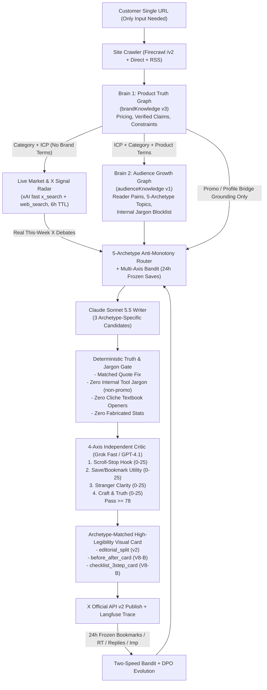

# VELOX AI V8 Master Architecture Blueprint: Autonomous Audience-First Growth & Editorial Intelligence Engine

> **Authority & Rules (`/home/songxiaj679/x-nurture-factory/AGENTS.md` Sections 1–6)**:
> - Authored by Antigravity (Chief Commander & Technical Architect) from first principles and live production telemetry (`@VeloxSystemsV4` & `@VeloxSystemsHQ` on `2026-11-20`).
> - **Complete Autonomy Mandate**: Must operate end-to-end from a **single customer URL** (or short goal) with zero ongoing manual prompt-writing by customers.
> - **Mandatory Grok Peer-Review**: Before implementation begins, Grok MUST review this blueprint, challenge assumptions, expose latency/cost/compliance blind spots, and return concrete engineering refinements. Antigravity will then synthesize both perspectives into the authoritative **V8-A Implementation Spec**.

---

## 1. Executive Diagnosis: Why V7 Is Clean Yet Won't Grow (Live Evidence)

V6–V7 solved trust, hallucination control, multi-model stability, visual rendering, suspension care, and cost bounds (`415` unit tests, zero AI slop, `langfuse 200`).
However, live production numbers from `2026-11-20` prove that **clean & accurate ≠ growing on X**:
- `@VeloxSystemsV4` `12:34 JST` (with visual card, 6h elapsed): **19 impressions, 0 likes, 0 bookmarks, 0 replies**
- `@VeloxSystemsV4` `17:37 JST` (1h elapsed): **2 impressions, 0 likes, 0 bookmarks**
- `@VeloxSystemsHQ` `12:31 JST` (6h elapsed): **2 impressions, 0 likes** (last 4 posts: `2–8` impressions)

### Five Root Causes Confirmed Directly in Production Code
1. **Product-Manual Trap (`src/lp_knowledge_extractor.js:390-470` + `src/next_post_draft.js:322, 488`)**:
   - `lp_knowledge_extractor.js` extracts `domainPlaybooks` **solely from the customer's product landing page**, then `next_post_draft.js` locks the writer to `focusPlaybook`.
   - Result: Daily posts paraphrase **internal tool settings** (`保存したアカウント像`, `送信前ゲート`, `紹介を希望する設定`, `画面の説明`) that strangers on X neither understand nor care about. This breaks growth for **every** URL-only SaaS/service customer.
2. **Dead-Wired Live X Radar (`src/context_radar.js:49-56` + `src/next_post_draft.js:634`)**:
   - `context_radar.js` calls `completeText({ search: true, xSearch: true, timeoutMs: 26000 })` without `tier: 'fast'`, defaulting to slow reasoning `grok-4.7` and aborting repeatedly (`[Context Radar] This operation was aborted`).
   - Worse, `src/next_post_draft.js:634` reads only `contextSignals.questions` and **never passes `contextSignals.signals` (live X industry debates) into `briefPrompt` or `candidatePrompt`**!
3. **100% Monotonous Textbook Structure (`src/next_post_draft.js:211-212, 544`)**:
   - All 3 of today's posts opened with the exact same cliché (`〜という見方があります` / `〜とよく言われます` → `ただ〜` → `確認は〜`).
   - Why? `focusPlaybook` only has one schema (`commonMistake -> checkCriteria -> boundaryCondition`), Candidate `b` mirrors it verbatim, and `criticSystemRules` rewards a single "concrete tradeoff" instead of scroll-stop hook, bookmark utility, and stranger comprehension.
4. **Over-Strict Numeric Filter (`src/draft_verifier.js:68-78`)**:
   - While fabricated empirical stats (`95%`, `3.2x`, `¥...`, fake dates/hours) MUST remain strictly banned, blocking structural numbers/practical character/step counts forces abstract, bloodless prose instead of concrete checklists and actionable X craft examples.
5. **Opening-Quote Stripping Bug (`src/official_api_client.js:388`)**:
   - `text.replace(/^(?:["'「『]|&quot;)+|(?:["'」』]|&quot;)+$/g, '')` strips the opening `「` even when `」` closes mid-sentence, corrupting today's `20:02 JST` queued post (`数字や強い言葉を足せば、説得力が出て反応も取れる」とよく言われます。`).

---

## 2. Strategic Answer: Can an Honestly-Labeled "Automated" Account Grow Organically?

**Yes — 100% achievable, IF the content shifts from "generic essays" to "High-Utility Reference Craft".**
- On X, automated/curated accounts with the `Automated` badge earn high bookmarks and steady follower growth when readers recognize them as a **reliable daily source of immediately usable frameworks, Before→After concrete rewrites, diagnostic checklists, and timely industry digests** — content people save even knowing it is curated/automated.
- **Compliance Boundary on Auto-Replies (Strict X Policy)**:
  - **Inbound Auto-Reply** (replying to users who mention/reply to the account, with `Automated` label + Phase 2 opt-in): **Compliant & beneficial** (deepens conversation score).
  - **Outbound Unsolicited Auto-Reply** (bot auto-replying to strangers who didn't mention you): **Strictly forbidden by X Platform Manipulation Policy** (leads to permanent suspension). Never automate unsolicited outbound replies.
  - **Outbound Discovery Assist (V8-C)**: AI finds 3–5 high-velocity relevant X discussions daily via `x_search` and drafts sharp replies/quotes for **1-click human review & send** in `/dashboard` — 100% compliant and optional.
  - **Core Rule**: Even with **zero manual replies**, V8's autonomous timeline posts MUST stand on their own and earn organic bookmarks, retweets, search discovery, and follows.

---

## 3. V8 Architecture: The Dual-Brain Autonomous Growth System



---

## 4. Detailed Subsystem Design

### Subsystem 1: Brain 2 — Autonomous Audience Intelligence Engine (`src/audience_knowledge_engine.js` [new])
Triggered automatically right after `extractBrandKnowledge` (cached 7 days per `contentHash + outputLang`, respecting `tenant_ai_budget.js`!):
- **Inputs**: `brandKnowledge` (`productName`, `category`, `icpSummary`, `oneLineMechanism`, `verifiedClaims`, `terminology`) + 1 fast external `x_search`/`web_search` call for what this ICP actually debates on X.
- **Outputs stored at `saas_users/{userId}.audienceKnowledge`** (`schemaVersion: 1`, strictly in `outputLang` `ja` or `en`):
  1. `readerPersona`: Plain-language profile of the target reader's daily job, top 3 recurring bottlenecks, and exact vocabulary they use on X.
  2. `internalToolJargonBlocklist` (string[], 10–25 terms): Auto-generated list of the vendor's internal UI/feature terms (e.g., for Velox: `送信前ゲート`, `保存したアカウント像`, `紹介を希望する設定`, `画面の説明`, `登録ページ`, `VELOX AI`, `URLを入力`, `同一ドメイン内の案内`). **Deterministically blocked in all non-promo daily posts!**
  3. `audienceTopics` (12–15 distinct reader-first cards, 2–3 per archetype — ZERO product UI instructions!):
     - `before_after_rewrite` cards: `{ id, archetype, topic, context, weakExample, strongExample, whyItWorks }`
     - `actionable_checklist` cards: `{ id, archetype, topic, readerPain, steps: [s1, s2, s3], boundaryNote }`
     - `failure_autopsy` cards: `{ id, archetype, topic, commonTrap, realCause, practicalFix, boundaryNote }`
     - `contrarian_sharp` cards: `{ id, archetype, topic, lazyBelief, sharpTruth, concreteCheck }`
     - `trend_lens` cards: `{ id, archetype, topic, practitionerStance, evaluationCriteria }` (paired with live `x_search` signals!)
- **Why This Works for ANY Customer URL**:
  - Dental clinic URL -> Brain 2 generates patient-facing dental care Before/After myths, 3-step brushing/clinic checklists, seasonal oral care trends (NOT "click our reservation button on the screen").
  - Accounting SaaS URL -> Brain 2 generates month-end closing checklists, invoice error Before/Afters, real tax-law X discussions (NOT "enter your URL into our pre-send gate").
  - VeloxPost Cloud URL -> Brain 2 generates real X growth craft: 1st-line hook rewrites (Before/After), zero-to-1k posting & engagement checklists, thread vs long-post formatting rules, real X algorithm/creator debates this week!

### Subsystem 2: Fast Live Market & X Signal Radar (`src/context_radar.js` Upgrade)
- **Fix Timeout Root Cause**: Explicitly use `tier: 'fast'` (`grok-4.20-0309-non-reasoning` or dedicated `XAI_MODEL_RADAR` supporting xAI Responses API `x_search` + `web_search`) with `timeoutMs: 22000`, persisted to `saas_users/{userId}.liveRadarCache` (6h TTL) so generation never blocks on repeated aborted calls.
- **Wire Into Generation (`src/next_post_draft.js`)**:
  - Actually pass `contextSignals.signals` into `briefPrompt` and `candidatePrompt` whenever `archetype === 'live_trend_brief'` (or as optional fresh framing for `contrarian_sharp` / `failure_autopsy`), with strict grounding: only reference the observable public topic/debate summarized by the radar — never fabricate quotes, dates, or statistics.
  - Add 1–2 natural organic search keywords (woven into normal prose, NOT spammy `#hashtags`) so X Search surfaces the post to non-followers actively looking up that topic.

### Subsystem 3: 5-Archetype Anti-Monotony Router (`src/editorial_archetypes.js` [new])
- **Strict Non-Repetition Memory**: Inspect the last 5 posted/pending jobs (`archetype`, `openingPattern`, `focusTopicId`).
  - Hard rule: **Never pick the same `archetype` as the last 2 posts.**
  - Default portfolio rotation (until >= 10 frozen 24h posts allow Bandit override):
    1. `before_after_rewrite` (~25% — highest bookmark driver)
    2. `actionable_checklist` (~25% — highest save/screenshot driver)
    3. `failure_autopsy` (~20% — high dwell & empathy)
    4. `live_trend_brief` (~15% — discovery & non-follower reach; falls back to `failure_autopsy` if radar has no fresh signal)
    5. `contrarian_sharp` (~15% — punchy short thesis, strictly `< 180` chars JA / `< 240` chars EN!)
- **Hard Cliché Opener Ban (`src/draft_verifier.js`)**:
  - Add `TEXTBOOK_CLICHE_OPENERS` check rejecting posts starting with or leaning on robotic preamble:
    - JA: `という見方があります`, `とよく言われます`, `と考えがちです`, `そう考えて運用する方がいます`, `多くの場合、`, `一般的には`
    - EN: `Many assume`, `Most operators assume`, `It is often said`, `There is a common view`
  - Force punchy, direct opening lines: Lead immediately with the **sharp conclusion**, **concrete Before/After contrast**, **specific reader pain scene**, or **live topic**.

### Subsystem 4: Deterministic Guardrail Calibration (`src/official_api_client.js` & `src/draft_verifier.js`)
1. **Fix Opening-Quote Stripping (`src/official_api_client.js:388`)**:
   - Strip outer quotation marks ONLY when matching opening AND closing quotes wrap the entire string (`"..."`, `「...」`, `『...』`) — never strip a solitary leading `「` when `」` closes mid-sentence!
2. **Internal Tool Jargon Gate (`src/draft_verifier.js`)**:
   - On non-promo posts (`!promo && role !== 'explicit_promo_offer'`), deterministically reject any draft containing terms from `audienceKnowledge.internalToolJargonBlocklist` (or generic internal-manual leakage like `登録ページ`, `送信前ゲート`, `保存したアカウント像`, `紹介を希望する設定`, `画面の説明` unless explicitly in a promo slot!).
3. **Smart Numeric Grounding (`src/draft_verifier.js:66-79`)**:
   - **KEEP strict ban** on any ungrounded empirical stat/metric (`%`, `％`, `倍`, `割`, `円`, `¥`, `$`, `万`, `億`, `社`, `人`, `件`, `時間`, `分`, `秒`, fake dates/clock times).
   - **ALLOW** clean structural list prefixes (`1.`, `2.`, `3.`, `①`, `②`, `③`, `Step 1/2/3`) so `actionable_checklist` posts can be formatted cleanly for X scannability without tripping `ungrounded_number`!

### Subsystem 5: 4-Axis Engagement-Calibrated Independent Critic (`src/llm_router.js` & `src/next_post_draft.js`)
Replace single-number "tradeoff" scoring with structured JSON 4-axis scoring (`grok-4.20-0309-non-reasoning`, fallback `gpt-4.1`):
```json
{
  "scores": [
    {
      "id": "a",
      "scrollStopHook": 21,
      "saveUtility": 22,
      "strangerClarity": 24,
      "craftAndTruth": 20,
      "score": 87,
      "weakness": "Opening line can cut 8 words to hit harder."
    }
  ]
}
```
- **Hard Sub-Score Floor**: Even if total >= 78, reject any candidate with `strangerClarity < 18` (sounds like internal tool docs) OR `scrollStopHook < 16` (boring textbook preamble) OR `saveUtility < 16` (nothing worth bookmarking)!
- **Max 1 Targeted Repair**: Repair prompt receives the exact lowest axis + concise `weakness` (keeping total latency comfortably under `50–70s`!).

### Subsystem 6: Archetype-Matched High-Legibility Visual Cards (`src/visual_card.js` — V8-B)
Build directly on our full-bleed white + top cobalt bar v2 design (`1200×675`, zero double-frame, crisp Noto Sans JP):
1. `editorial_split` (existing v2 — paired with `failure_autopsy` / `contrarian_sharp`).
2. `before_after_card` (NEW — paired with `before_after_rewrite`):
   - Top/Bottom stacked full-width comparison cards (`❌ 反応が止まる例 / Before` in soft rose-tinted `#FFF1F2` border `#FECDD3` -> `✅ 保存される改善例 / After` in crisp cobalt-tinted `#EFF6FF` border `#93C5FD`) + 1-line bold takeaway footer. Readable in 0.8 seconds on mobile X!
3. `checklist_3step_card` (NEW — paired with `actionable_checklist`):
   - 3 clean horizontal numbered rows (`01` / `02` / `03` bold cobalt circles + 1 crisp sentence each, `30–34px` bold text) + 1-line boundary note. Maximum screenshot & bookmark velocity on X!
- **Measurement Purity**: Every job & `generation_traces` doc records `archetype`, `visualCard.template`, `visualCardAttached`, and 4-axis Critic scores, feeding the 24h frozen Weighted Save Bandit:
  `saveScore = ((bookmarks * 4) + (retweets * 3) + (replies * 2) + likes) / impressions`

### Subsystem 7: Compliant Growth Discovery Assist (`src/outbound_discovery.js` [new] — V8-C)
- Runs on a lightweight daily schedule (respecting `tenant_ai_budget.js`, opt-in or dashboard tab):
  - Uses xAI `x_search` to discover 3–5 recent (`< 12h`), high-signal X posts in the customer's exact niche (excluding spam, politics, self, blocked authors).
  - Claude drafts 1 concise, zero-pitch, high-value practitioner reply or Quote-Post note grounded in `audienceKnowledge`.
  - Displayed in `/dashboard` under a clean bilingual **"会話チャンス（確認して送信）" / "High-Signal Conversations (Review & Send)"** panel.
  - **STRICT COMPLIANCE**: Zero unattended outbound posting; human clicks Approve & Send (passing all V7-B safety guards: opt-out, cooldown, daily cap, zero URL/hype).

---

## 5. Stack, Latency, Cost & Risk Analysis

| Component | Technology (All Already Live!) | Est. Added Latency | Est. Added Cost / Post | Risk & Mitigation |
|---|---|---|---|---|
| Brain 2 (`audienceKnowledge`) | Claude Sonnet 5.5 + xAI `x_search` (cached 7 days) | `0ms` per post (1x/week ~15s) | ~\$0.015 / week | Unified `tenant_ai_budget` cap; falls back to existing playbooks if budget exhausted |
| Live Signal Radar (`x_search`) | xAI fast Responses API (cached 6h in Firestore) | `0ms` on cache hit (~4–8s / 6h) | ~\$0.005 / 6h | Never blocks posting; falls back cleanly to evergreen archetype |
| 5-Archetype Writer | Claude Sonnet 5.5 (Prompt Cache hit!) | ~20–30s (same as V7) | ~\$0.015–0.025 / post | Existing `max_tokens >= 3200` floor + Grok fallback |
| 4-Axis Critic | `grok-4.20-0309-non-reasoning` (fallback `gpt-4.1`) | ~1.2–2.0s | ~\$0.001 / post | Strict sub-score floor (`strangerClarity >= 18`, `scrollStopHook >= 16`) |
| 3 Visual Templates (`v2`) | Local `Satori` + `@resvg/resvg-js` | ~0.6s | **\$0.000** | Zero external image API cost; 100% crisp Japanese & English typography |
| Outbound Discovery Assist | xAI `x_search` + Claude (1x/day, 3–5 cards) | Async background | ~\$0.02 / day | Strictly human-approved; zero unsolicited bot replies (zero X ban risk) |

**Total Monthly COGS per Active Starter Customer (30 posts/mo)**: ~\$1.00–\$1.50/month (massive SaaS gross margin > 90%!).

---

## 6. Phased Implementation Roadmap

- **Wave V8-A (Core Growth Revolution — Highest Immediate Impact)**:
  1. Fix `sanitizePostOrReplyText` opening-quote stripping (`src/official_api_client.js:388`).
  2. Build `src/audience_knowledge_engine.js` (Brain 2: `readerPersona`, `internalToolJargonBlocklist`, 12–15 reader-first `audienceTopics` across 5 archetypes, strictly bilingual `ja`/`en`).
  3. Upgrade `src/context_radar.js` (fast model, 6h Firestore cache, zero silent aborts) and wire `contextSignals.signals` into `src/next_post_draft.js`.
  4. Build `src/editorial_archetypes.js` (5-archetype anti-monotony router) + `src/draft_verifier.js` upgrades (jargon blocklist gate, cliché opener ban, structural `①②③`/`1.2.3.` allowance while keeping empirical stats strictly banned).
  5. Upgrade Critic in `src/llm_router.js` & `src/next_post_draft.js` to the 4-Axis Growth Rubric (`>= 78` total + sub-score floors).
  6. Live test on `@VeloxSystemsV4` & `@VeloxSystemsHQ` (replace pending drafts and compare before/after quality immediately!).
- **Wave V8-B (Bookmark Multiplier Visual Cards)**:
  - Add `before_after_card` and `checklist_3step_card` to `src/visual_card.js` + dashboard preview & showcase support + per-template Bandit tracking.
- **Wave V8-C (Distribution Accelerator & Retention Polish)**:
  - Outbound Conversation Discovery Assist (human-approved 1-click reply/quote queue in `/dashboard`) + `uiLang` persistence on `saas_users` + budget-degraded audit reason telemetry + `activationSeconds` backfill.

---

## 7. Mandatory Grok Peer-Review Questions (Before Coding V8-A)

Grok MUST review this blueprint and answer specifically:
1. **Truth vs. Utility Balance**: When Brain 2 generates concrete `before_after_rewrite` examples or `actionable_checklist` steps from general domain expertise (NOT verbatim text on the customer's LP), where is the exact safe line so VELOX AI never invents false claims about the customer's product/customers/stats, while still writing vivid, concrete practitioner examples?
2. **xAI `x_search` Model & Timeout Reliability**: Which exact xAI model/endpoint parameter currently executes `x_search` reliably within `< 15s` without triggering `[Context Radar] This operation was aborted`?
3. **4-Axis Critic Latency & Pass Rate**: Will requiring `>= 78` total AND sub-score floors (`strangerClarity >= 18`, `scrollStopHook >= 16`, `saveUtility >= 16`) cause too many `PostConstraintError` hard stops on `grok-4.20-0309-non-reasoning`? What exact thresholds / fallback logic prevent false rejections while still killing dull tool-manual drafts?
4. **Automated Account Engagement Strategy**: Do you agree with keeping `V8-A` focused on autonomous timeline craft (so even `Automated`-labeled accounts earn bookmarks/follows) before adding `V8-B` visual cards and `V8-C` human-approved discovery replies? Any blind spots or higher-leverage ideas?
5. **Migration & Existing Tests**: Which existing unit tests (e.g. `tests/v6_phase1_router_and_craft.test.js`, `tests/velox_polish_and_scaling.test.js`, `tests/dashboard_language.test.js`) assume the old single-score Critic or old `domainPlaybooks` structure and need backward-compatible handling?
