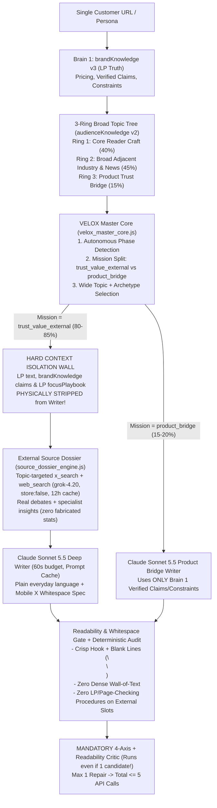

# VELOX AI V8-Core Master Program Spec: Autonomous Editorial Commander + 3-Ring Broad Topic Expansion + Hard LP Isolation + External Source Dossier + Mobile X Readability Engine (for Grok)

> **Follow `/home/songxiaj679/x-nurture-factory/AGENTS.md` Sections 1–6 strictly**:
> - Synthesized by Antigravity from the founder's strategic architecture directive (`2026-11-20`), Antigravity's root-cause code audit of V8-A (`src/next_post_draft.js:364, 703, 715, 761, 798`), and Grok's candid V8-A self-audit.
> - **Core Principle (Founder Directive)**:
>   1. **Master Program (Core Brain)**: VELOX AI must autonomously decide growth phase, broad topic derivation, source gathering, archetype, and formatting from minimal input (a single URL or short persona).
>   2. **Quality Over Speed, Cost-Bounded by Architecture**: Scheduled posts prepare hours ahead — never starve depth or source quality for arbitrary 28–35s timers. Instead, prevent cost bloat by **strictly capping API calls per post** (1 cached Source Dossier + 1 Brief + 1 Deep Writer + 1 Mandatory Critic + max 1 Repair = **<= 5 purposeful calls max, zero retry loops**).
>   3. **Escape the Product-LP Echo Chamber**: In the `trust_building` phase, ~80–85% of posts MUST deliver genuine reader value from **broadly expanded adjacent topics + external sources/current affairs + accessible specialist knowledge** — by **physically removing the customer LP and LP-derived `focusPlaybook` from the Writer's prompt**!
>   4. **Mobile X Readability & Whitespace (余白の設計)**: Every post > 110 JA chars / > 180 EN chars MUST breathe visually on smartphone screens (short crisp hook + blank lines `\n\n` + max 2 sentences per block + plain, natural Japanese/English explaining specialist concepts clearly).
> - **Visual Card Discipline**: Still do NOT add new visual card templates until V8-Core's live offline drafts prove clean separation from LP self-explanations. Keep `editorial_split` v2 unchanged for V8-Core; V8-B (`before_after_card` / `checklist_3step_card`) immediately follows once V8-Core output passes our quality bar!

---

## Root Cause Found in V8-A (Why Offline Drafts Still Talked About "Checking the Registered Page")
Antigravity audited live Firestore Brain 2 cards (`aud_1..aud_14` on `@VeloxSystemsV4` & `@VeloxSystemsHQ`) and `src/next_post_draft.js`:
1. **Brain 2's cards were already clean** (e.g. `更新が止まったあとの再開投稿`, `予約投稿が機械的に見える問題`, `Turning a feature list into a post a stranger would stop for`).
2. **Yet `src/next_post_draft.js` (`L364, L703, L715, L761`) STILL injected BOTH `Page` (the full `veloxpostapp.com` LP!) AND `focusPlaybook` (the LP-derived `pb_1: URL入力と事実検証の使い方` with `"使う判断カードはこの1件だけ"`!) into `briefPrompt` and `candidatePrompt`!** That forced Claude to ignore Brain 2 and rewrite `"登録ページか同一サイト内の案内に書かれているか照らします"`.
3. **Line 798 (`if (!skipCriticScore && accepted.length >= 2)`) skipped the 4-Axis Critic whenever only 1 candidate survived deterministic checks!**
4. **`internalToolJargonBlocklist` included generic everyday workflow words (`次の1本`, `next-post drafting`)**, causing clean practical drafts to be falsely rejected.

---

## Architecture: The VELOX AI Master Core (`src/velox_master_core.js` [new])



---

## Scope (6 Focused, Cohesive Deliverables)

### 1. Build `src/velox_master_core.js` [new] — The Autonomous Editorial Commander
Create one clean, deterministic-first core module that orchestrates every scheduled post decision (`decideNextPostMission({ user, accountState, brandKnowledge, audienceKnowledge, recentPosts, recentJobs, portfolioPlan })`):
1. **Autonomous Account Phase Determination**:
   - `trust_building`: followers `< 500` OR mature posted count `< 15` -> **85% `trust_value_external` (Ring 1 + Ring 2) / 15% `product_bridge` (Ring 3)** (unless `portfolioPlan.allowPromoUrl === true` or user explicitly requested promo).
   - `authority_growth`: followers `500–2,999` -> **75% `trust_value_external` / 25% `product_bridge`**.
   - `conversion_ready`: followers `>= 3,000` -> **70% `trust_value_external` / 30% `product_bridge`**.
2. **Mission Selection (`mission`)**:
   - Inspect last 6 jobs' `mission` (`trust_value_external` vs `product_bridge`).
   - Enforce the phase ratio automatically (e.g., in `trust_building`, at most 1 `product_bridge` per 6 posts; never 2 `product_bridge` posts in a row!).
   - **Hard Context Isolation Rule**: When `mission === 'trust_value_external'`, set `isolateLpContext: true` -> `next_post_draft.js` **MUST NOT** pass `page` (LP body/headings), `brandKnowledge.verifiedClaims`, `brandKnowledge.oneLineMechanism`, or LP-derived `focusPlaybook` into `briefPrompt` or `candidatePrompt`!
3. **Wide Topic-Ring & Archetype Selection**:
   - Rotates cleanly across **Ring 1 (Direct Reader Craft)** and **Ring 2 (Broad Adjacent Industry / Current Affairs / Specialist Knowledge)** + the 5 archetypes (`before_after_rewrite`, `actionable_checklist`, `failure_autopsy`, `live_trend_brief`, `contrarian_sharp`), never repeating the same `ring + topicDomain` or same `archetype` in the last 2 posts.
   - Returns a structured `masterPlan`:
     ```js
     {
       phase: 'trust_building' | 'authority_growth' | 'conversion_ready',
       mission: 'trust_value_external' | 'product_bridge',
       isolateLpContext: true | false,
       topicRing: 'ring1_craft' | 'ring2_broad_adjacent' | 'ring3_product_bridge',
       selectedTopicDomain: string, // e.g. "X投稿の1行目コピーライティング" / "AI時代の小規模ビジネス発信設計"
       archetype: string,
       focusTopic: object | null,
       sourceQuery: string,         // Clean external search query (ZERO brand/product names!)
       maxApiCalls: 5               // Hard cost guardrail
     }
     ```
   - Persist `masterPhase`, `masterMission`, `topicRing`, `selectedTopicDomain` on both `autopilot_jobs` and `generation_traces` (and Langfuse metadata) for full observability!

---

### 2. Upgrade Brain 2 (`src/audience_knowledge_engine.js`) to **3-Ring Broad Topic Tree (`schemaVersion: 2`)** + Clean Jargon Filter
- **Problem Fixed**: In V8-A, Brain 2 still stayed narrow around "posting tools" and put everyday words like `次の1本` / `next-post drafting` into `internalToolJargonBlocklist`.
- **Upgrades**:
  1. **Wide Associative Expansion (`broadTopicDomains`, 8–12 broad adjacent fields)**:
     - From `category`, `icpSummary`, and `userPrompt` (ZERO product feature list fed to Brain 2!), ask Claude Sonnet 5.5 to derive:
       - **Ring 1 (`ring1_craft`, 4–6 domains)**: Direct practical skills the target reader wants to master (e.g., for an X SaaS: Xの1行目フック設計、スマホで読まれる文章構成と余白、スレッドと長文の使い分け、プロフィールと固定ポスト導線、返信と会話で信頼を作る技術).
       - **Ring 2 (`ring2_broad_adjacent`, 4–6 domains)**: Broader adjacent domains & current industry themes that the same reader eagerly reads & bookmarks on X (e.g., AI時代の個人開発・スモールビジネス発信、LPとSNSの言葉選び、時間がない経営者の発信習慣、最新SNSアルゴリズムや生成AI活用の実務論).
     - Generate **12–16 `audienceTopics` cards** spread across BOTH `ring1_craft` AND `ring2_broad_adjacent` (each card tagged `topicRing: 'ring1_craft' | 'ring2_broad_adjacent'`, `topicDomain`, `exampleKind: 'illustrative'`).
     - **Explicit Prohibition Inside Brain 2 Prompt & Scrubber**: NEVER generate cards about "checking a registered LP page before scheduling", "entering a URL into an app", or "how an automation tool works". Every card MUST be something a human practitioner in that industry would bookmark even if the customer's product didn't exist!
  2. **Clean, Non-Overbroad `internalToolJargonBlocklist`**:
     - Adopting Grok's V8-A feedback: Restrict `internalToolJargonBlocklist` strictly to **proper product/brand names** (`productName`) and **product-specific UI/feature labels** (`送信前ゲート`, `Developer Exhibit`, `登録ページ`, `同一サイト内の案内`, `保存したアカウント像`, `紹介を希望する設定`, `公式OAuth`, `saved page`, `registered page`, `site URL reader`).
     - Deterministically strip overly generic everyday phrases (`次の1本`, `投稿`, `確認`, `draft`, `posting`, `workflow`) so genuine practical posts are never falsely blocked!
  3. **Cache & Coexistence**: Bump `audienceKnowledge.schemaVersion` to `2` (7-day TTL, keeping `brandKnowledge.schemaVersion === 3` and `domainPlaybooks` completely untouched!).

---

### 3. Build `src/source_dossier_engine.js` [new] — Topic-Targeted External Source Collector (Quality-First, Cost-Bounded)
- **Why**: Relying on a single generic category radar (`"継続的なX運用"`) gave thin, repetitive hints. To write genuinely insightful posts, VELOX AI must gather **external source material specifically about today's chosen `selectedTopicDomain`**.
- **Exact Design**:
  - Input: `{ topicDomain, readerPersona, lang, excludedXHandles, db, userId, user, now }` (ZERO product names or LP text!).
  - **12-hour Firestore Cache** under `collective_intelligence/source_dossiers_v1` keyed by `sha256(topicDomain + '|' + lang)` -> shared cleanly across runs & accounts in the same domain, zero duplicate API burn!
  - On cache miss: runs **1 fast xAI Responses API call** (`grok-4.20-0309-non-reasoning`, `store: false`, `timeoutMs: 18000`, checking `checkTenantAiBudget` and recording 1 call ONLY on success!):
    - Tool strategy: `[{ type: 'x_search' }]` (with `excluded_x_handles` when provided) OR for `ring2_broad_adjacent` / current affairs optionally `[{ type: 'web_search' }]` (1 single tool per call — NEVER bundle two slow tools together in one timeout!).
    - Prompt asks for a **qualitative practitioner Source Dossier JSON**:
      ```json
      {
        "currentDebate": "What practitioners in this field are actually arguing or struggling with right now (1-2 sentences, qualitative, no fake stats)",
        "concreteAngles": ["Practical angle 1", "Practical angle 2"],
        "specialistInsight": "One deeper technical/domain principle explained in plain everyday language",
        "avoidCliches": ["Overused shallow advice everyone repeats on X"]
      }
      ```
  - **Deterministic Scrubbing**: Strip any unverified Arabic percentages/monetary stats/dates and product names before saving/passing to the Writer (preventing leaked tweet stats like `0.45%`!).
  - On abort/error: return `null` cleanly (do NOT retry in a loop — Writer still has Brain 2's expanded topic card + Claude's broad domain mastery!).

---

### 4. Hard Context Isolation + Generous Background Budgets + Mandatory Critic (`src/next_post_draft.js`, `src/autonomous_promo_ai.js`)
1. **Physically Isolate LP Context on `trust_value_external` Posts (`src/next_post_draft.js`)**:
   - When `masterPlan && masterPlan.isolateLpContext === true` (i.e. `mission === 'trust_value_external'`):
     - Do **NOT** pass `page` (LP body/title/headings), `brandKnowledge.verifiedClaims`, `brandKnowledge.oneLineMechanism`, `brandKnowledge.verifiedConstraints`, or LP `focusPlaybook` into `briefPrompt` or `candidatePrompt`!
     - Pass ONLY: `voiceProfile` (tone/register/accountRole), `audienceKnowledge.readerPersona`, `masterPlan` (`topicRing`, `selectedTopicDomain`, `archetype`, `focusTopic`), `sourceDossier` (external live X/web context + specialist insight), `recent` (anti-repetition), `ngTopics`, and `accountState` (char limit/shape)!
     - Explicitly instruct Claude: *"Explain specialist/practical knowledge in crystal-clear everyday Japanese/English that a total stranger immediately finds useful and wants to bookmark. Do NOT reference any product page, registered URL, or tool setup steps."*
   - When `mission === 'product_bridge'` or `promo === true`: keep full Brain 1 (`brandKnowledge`) grounding active exactly as before!
2. **Quality-First Background Budgets (Zero Retry Bloat!)**:
   - In `prepareNextPost` (`src/autonomous_promo_ai.js`), raise background `timeoutMs` from `110000` to `180000` (3 minutes — runs hours before publish!), giving `briefBudget` up to `45000ms` and `candidateBudget` up to `60000ms` (while keeping synchronous interactive fast-tier calls like `tier === 'fast'` capped tightly at `18000ms` so `tests/launch_progress_and_uilang.test.js` stays 100% green!).
   - Hard cap API calls inside `draftNextPostWithMeta`: 1 Brief + 1 Candidate Writer + 1 Mandatory Critic + max 1 Repair = **<= 4 LLM calls inside drafting** (+ max 1 cached Source Dossier = <= 5 total).
3. **Mandatory 4-Axis Critic Even for 1 Candidate (`src/next_post_draft.js:798`)**:
   - Change `accepted.length >= 2` to **`accepted.length >= 1`**!
   - Even if only 1 candidate passes deterministic checks, it MUST still be evaluated by the 4-Axis Critic (and repaired once if `strangerClarity < 14`, `scrollStopHook < 12`, or `score < 72`), eliminating the loophole where an unscored draft slipped through!

---

### 5. Mobile X Readability & Whitespace Engine (`src/readability_formatter.js` [new] + `src/draft_verifier.js` + `src/next_post_draft.js`)
Implementing the founder's crucial insight on visual whitespace & effortless reading on smartphone X feeds:
1. **Deterministic Readability Audit (`auditReadability(tweets, { lang, formatName })` in `src/readability_formatter.js`)**:
   - For non-`micro_punch` posts with length `>= 110` JA chars (`>= 180` EN chars):
     - **First-line hook**: Must be separated from the rest by a blank line (`\n\n`) and first line length `<= 48` JA chars (`<= 110` EN chars) so the reader catches the hook in 0.5 seconds.
     - **No Dense Wall-of-Text Paragraphs**: Reject any single paragraph block exceeding `105` JA chars (`220` EN chars) without a line break (`\n`) when the post is `>= 140` JA chars (`>= 240` EN chars).
     - **Breathing Room**: Posts `>= 150` JA chars (`>= 240` EN chars) MUST contain at least **2 blank-line separators (`\n\n`)** (3 airy visual chunks — Hook -> Core Insight/Steps/Before-After -> Crisp Takeaway!).
   - **Auto-Safe Whitespace Helper** (optional gentle check in Writer prompt + Critic rubric): explicitly tell Claude to format with generous blank lines (`\n\n`), short scannable lines (especially for `Before / After` and `・` / `1. 2. 3.` checklists), and plain everyday wording (translating specialist concepts cleanly without stiff corporate words).
2. **Hard Ban on LP-Verification Meta-Procedures in `trust_value_external` Posts (`src/draft_verifier.js`)**:
   - When `context.isolateLpContext === true`, deterministically reject drafts mentioning LP verification procedures (`登録ページ`, `同一サイト内の案内`, `ページに書かれた機能`, `保存したアカウント像`, `saved page`, `registered page`) -> reason `lp_meta_leak`!
   - Add readability failures (`dense_wall_of_text`, `missing_hook_break`) into `runDeterministicAudit` cleanly when `context.enforceReadability === true` (enabled in live `next_post_draft.js`, leaving legacy synthetic single-line unit test fixtures unbroken!).

---

### 6. Fix English `x_search` Query Diversity (`src/context_radar.js` + `src/source_dossier_engine.js`)
- Adopting Grok's V8-A catch: In `@VeloxSystemsHQ`, the English query repeated `"ai assisted x posting workflow"` into 1 collapsed item.
- By driving `source_dossier_engine.js` from each distinct **Ring 1 / Ring 2 `selectedTopicDomain`** (e.g., `"B2B X writing hooks and bookmarks"`, `"solo founder content strategy without burnout"`, `"short vs long posts on X algorithm"`) instead of the LP's own subtitle (`"AI-Assisted X Posting Workflow"`), English `x_search` automatically produces diverse, rich real-world topics every single day!

---

## Required Verification Checklist (Must All Pass After Final Edit)
1. `node --check` on every edited/new `.js` file (`src/velox_master_core.js`, `src/source_dossier_engine.js`, `src/readability_formatter.js`, `src/audience_knowledge_engine.js`, `src/context_radar.js`, `src/draft_verifier.js`, `src/next_post_draft.js`, `src/autonomous_promo_ai.js`, and tests).
2. Inline `<script>` `vm.Script` check on `views/dashboard_view.html` and `views/funnel_index.html`.
3. Full non-emulator test suite:
   ```bash
   grep -L "FIRESTORE_EMULATOR_HOST" tests/*.test.js | xargs node --test --test-concurrency=1 --test-force-exit
   ```
   PLUS standalone `node --test --test-force-exit tests/post_constraint_stop_isolation.test.js` -> **0 fail / 0 skip** (`>= 421` + new V8-Core tests).
4. New unit tests (`tests/v8_master_core_and_readability.test.js`):
   - `velox_master_core`: determines `trust_building` phase (<500 followers -> 85% `trust_value_external` / 15% `product_bridge`), enforces `isolateLpContext: true` on external value slots, never schedules 2 `product_bridge` posts in a row, rotates cleanly across Ring 1 & Ring 2 domains + 5 archetypes.
   - `next_post_draft`: when `isolateLpContext: true`, verifies that **zero LP body text / `verifiedClaims` / LP `focusPlaybook`** appear in the prompts sent to the Writer, AND verifies the 4-Axis Critic runs even when `accepted.length === 1`!
   - `source_dossier_engine`: queries using `selectedTopicDomain` (zero brand name), uses `grok-4.20-0309-non-reasoning` + `store: false`, scrubs numeric stats/quotes, caches 12h, and returns `null` cleanly on abort without retry loops.
   - `readability_formatter` + `draft_verifier`: rejects dense wall-of-text paragraphs & missing hook blank lines (`dense_wall_of_text`, `missing_hook_break`), rejects LP meta-procedures (`lp_meta_leak`) on `isolateLpContext: true` slots, and passes clean airy multi-chunk posts with `\n\n` breathing room.
   - `audience_knowledge_engine`: `schemaVersion: 2` builds both `ring1_craft` and `ring2_broad_adjacent` topics and keeps `internalToolJargonBlocklist` free of generic everyday words (`次の1本`, `draft`).
5. PM2 restart (`pm2 startOrRestart ecosystem.config.js --only x-shop --update-env && pm2 save`) + HTTP checks (`/` 200, `/?lang=en` 200, `/dashboard` 302, unauthenticated card/weekly 401).
6. **Live Proof of Transformation (Offline Dry-Run Comparison — Do NOT overwrite live pending jobs!)**:
   - Rebuild `audienceKnowledge` (`schemaVersion: 2`) for `@VeloxSystemsV4` (JA) and `@VeloxSystemsHQ` (EN) -> report the expanded **Ring 1 & Ring 2 `broadTopicDomains`**!
   - Run **3 live offline V8-Core dry-run drafts** (with `isolateLpContext: true` + real `source_dossier_engine` + mandatory 4-Axis Critic):
     1. `@VeloxSystemsV4` (JA) — `before_after_rewrite` (Ring 1 or Ring 2)
     2. `@VeloxSystemsV4` (JA) — `actionable_checklist` or `live_trend_brief` (Ring 2 broad/current topic!)
     3. `@VeloxSystemsHQ` (EN) — `before_after_rewrite` or `failure_autopsy` (Ring 1/Ring 2)
   - Paste the **complete verbatim drafts (preserving exact blank lines `\n\n`!)**, the `selectedTopicDomain` + `topicRing`, the live Source Dossier summary & latency, and the **4-Axis Critic scores** (must be populated on EVERY draft, never empty!) so the founder and Antigravity can judge the leap in quality, breadth, and whitespace readability directly!
   - Share your peer-review assessment and readiness check for **V8-B (Before/After & 3-Step Visual Cards)**.
